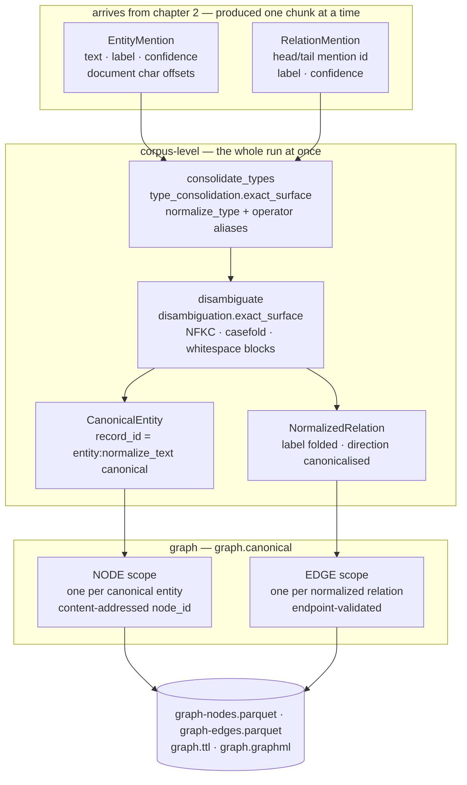

# 3 · From corpus to knowledge graph

*Chapter 2 left the pipeline holding a pile of local observations: one `EntityMention` per span
a model found in one chunk, one `RelationMention` per pair of those spans, each carrying a label
that chunk induced for itself, a confidence, and character offsets that resolve back to a page.
Nothing in that pile knows that the `ORG` called "Acme Corp." in document 14 and the `org` called
"ACME CORP" in document 900 are the same company — or that they are the same **kind** of thing.
This chapter is where that gets decided, and where the decisions become a graph you can query and
audit.*

Three stages do it — type consolidation
([ADR-0054](../adr/0054-type-vocabulary-canonicalization-is-a-capability-of-the-resolution-phase.md)),
disambiguation and graph assembly — and the campaign's generator configures them exactly like
this (`s3-multihop_rag` is the corpus id of one of the five pipelines):

```yaml
- name: consolidate_types
  capability: type_consolidation
  provider: type_consolidation.exact_surface
  depends_on: [extract]
- name: disambiguate
  capability: disambiguation
  provider: disambiguation.exact_surface
  depends_on: [consolidate_types]
- name: graph
  capability: graph_assembly
  provider: graph.canonical
  depends_on: [disambiguate]
  config:
    corpus_id: s3-multihop_rag
```

Three stages, one model between them: **none**. Every provider named above is pure Python,
deterministic and dependency-free. The learned options exist — and this chapter covers them —
but the campaign stack does not use them, so these three stages give the same graph for the same
input records.

The five pipeline files committed under `benchmark/sota-campaign/stages/s3-pipeline/pipelines/`
are the record of the August 2026 run. Their `graph` stage carries two more config blocks,
`hyperedges` and `graph_features`. Both features were removed by
[ADR-0068](../adr/0068-query-time-retrieval-tooling-is-removed-embedders-stay-only-as-a-resolution-signal.md).
Those files no longer load, because each also declares an `enrich` Stage whose Capability is
gone. The two blocks alone would not stop a run: `graph.canonical` reads `corpus_id` and
`max_evidence_per_node` and ignores every other key. `latence stack check` reports
`graph_features` as an error and says nothing about `hyperedges`.

---

## Extract narrow, resolve wide

The single design commitment behind this chapter is that **consistency is earned downstream, never
imposed upstream**.

The alternative — the one most KG pipelines pick — is to freeze one schema before extraction: union
the corpus's candidate types, cap the union to something a model can score against, and hand that
fixed label set to every chunk. It buys consistency at the extractor, and the price is paid three
times over, all of it recorded in `packages/latence-core/src/latence_core/stacks/phase_boundary.py`:

- **Recall.** The cap is where recall goes to die. A type a corpus mentions in exactly one chunk
  ranks below the salience cut and is dropped — from the one chunk that needed it, invisibly.
- **Precision.** A chunk scored against a ~40-type corpus union competes against ~35 types that are
  not in it.
- **Memory.** GLiNER2's span-scoring tensor is `batch × tokens × labels`. When `labels` was
  corpus-wide, that was the CUDA OOM.

So extraction stays local and narrow: each chunk gets its own small label set (chapter 2), and it
gets to be inconsistent. Then the pipeline crosses a line, and everything after it sees the whole
corpus at once and *earns* the consistency: one canonical type vocabulary, one canonical entity per
real-world thing, one graph.

### The line has teeth, and it was once permeable

The line is a machine-checked invariant: **no chunk-level stage may transitively depend on a
corpus-level one.** Since redaction is chunk-level, that is exactly "no corpus-level operation runs
before redaction" — but expressed over the DAG rather than over one topological schedule, so a
clean result holds for *every* valid execution order, not just the one the runner happened to pick.

That invariant is a privacy control, not a tidiness rule. A corpus-level stage in the front half
collapses the whole corpus into one shared artifact and stamps it back onto every chunk. Which
means: a fact from an unredacted document can reach a chunk it was never part of, before redaction
had a chance to run. Whatever the artifact is — a type vocabulary, an entity table, a co-occurrence
matrix — it is a covert channel across document boundaries.

The instructive part is that the invariant **failed silently**, and the module docstring of
`packages/latence-core/src/latence_core/capability_descriptor.py` records exactly how:

> ``TYPE_CONSOLIDATION`` (T3, ADR-0054) was added to the Runner's accumulator tuple and to the
> DeltaRunner's corpus-level tuple but to **neither** set in ``stacks/phase_boundary``.
> ``is_corpus_level`` therefore answered *False* for a Stage that collapses the whole run's mentions
> into one canonical type vocabulary, and ``check_phase_boundary`` — the invariant whose entire job
> is "no corpus-level operation runs before redaction" — waved a hand-written config that put
> ``consolidate_types`` in the front half straight through.

Read that carefully. Nothing crashed. No test went red. The guard *ran*, and *passed*, on a
pipeline that violated the exact property it exists to enforce — because the new capability was
registered as corpus-level in two places out of three, and the third place was the one the guard
read. And the same module notes the twist that makes it worse: `phase_boundary.CHUNK_LEVEL_KINDS`,
the set that should have caught the omission from the other side, "was worse than stale: it was
referenced by no code at all, documentation posing as a guard."

The fix is the transferable lesson, and it is not "be more careful". A capability's level is a fact
about the **capability**, so it is declared once, as a field, next to its siblings:

```python
    CapabilityDescriptor(
        kind=CapabilityKind.TYPE_CONSOLIDATION,
        protocol=TypeConsolidator,
        # T3/ADR-0054: a mention→mention transform re-emitting BOTH carriers relabelled, so it
        # checkpoints the same MIXED carrier a fused extractor does.
        carrier=Record,
        # Corpus-level BY CONSTRUCTION: a canonical type vocabulary cannot be elected from a prefix
        # of the labels, only from all of them. THIS is the fact that was missing from
        # phase_boundary — declaring it here is what closes the hole for every consumer at once.
        level=CapabilityLevel.CORPUS,
```
<small>`packages/latence-core/src/latence_core/capability_descriptor.py:498-507`</small>

The derived sets every other module used to hand-maintain — `CORPUS_LEVEL_KINDS`,
`DOCUMENT_LEVEL_KINDS`, `ACCUMULATOR_KINDS` — are now *computed* from the descriptors, and
`DOCUMENT_LEVEL_KINDS` is the exact complement of `CORPUS_LEVEL_KINDS` over the DAG kinds. A
partition, not two lists that hopefully agree; a kind can no longer land in neither. And the table
is checked for exhaustiveness **at import**: add a `CapabilityKind` without declaring its facts and
the first `import latence_core` raises a typed error. There is no code path where a new capability
merely *behaves* wrongly.

For an architect evaluating this, that is the shape of control worth looking for: the guarantee is
not that someone remembered, it is that forgetting is unrepresentable.

---

## The shape of the whole chapter



The wiring is a straight line. `graph` declares `depends_on: [disambiguate]` and reads one
stream, the `DisambiguationRecord`s: its `assemble` method takes nothing else
(`packages/latence-core/src/latence_core/stages/graph_assembly.py:91`). In the campaign stack no
stage of this chapter reads chunk text. The learned disambiguators below do: the Runner hands them
the run's chunks so that they can read the text around a mention.

---

## Stage 9 · Type consolidation

The extractor induced `org` in one chunk, `Organization` in another, `ORGS` in a third and
`company` in a fourth. All four name the same type. This stage folds them into one vocabulary and
rewrites every record onto it, **before** entity resolution — because the resolver votes a cluster's
type from its members' labels and gates its low-precision rungs on type *compatibility*. Feed it a
drifted vocabulary and it both splits clusters that belong together (`org` vs `organization` reads
as a type mismatch) and mistypes the ones that survive.

### What "exact surface" actually matches on

`type_consolidation.exact_surface` is the cascade provider with three rungs hard-disabled — and not
overridable, because the rung set *is* the varying behaviour behind the seam:

```python
    def __init__(self, config: dict[str, Any] | None = None) -> None:
        cfg = dict(config or {})
        # The defining properties; not overridable (the seam's varying behaviour IS the rung set).
        cfg["enable_acronym"] = False
        cfg["enable_prefix"] = False
        cfg["use_embedding_merge"] = False
        super().__init__(cfg)
```
<small>`packages/latence-core/src/latence_core/stages/type_consolidation.py:319-325`</small>

What survives is normalized-surface equality plus an operator alias map. The campaign configures no
aliases, so in the campaign stack **only the first rung ever fires**, and the whole behaviour of the
stage reduces to one function:

```python
def normalize_type(label: str) -> str:
    lowered = label.strip().lower().translate(_PUNCTUATION_TO_SPACE)
    tokens = [_depluralize(token) for token in lowered.split() if token]
    return " ".join(tokens)
```
<small>`packages/latence-core/src/latence_core/type_consolidation.py:84-94`</small>

`_PUNCTUATION_TO_SPACE` maps `_-/\.,;:()[]{}"'`` ` to spaces; depluralisation strips a trailing `s`
only from tokens longer than three characters that do not end in `ss`, `us` or `is` — so
`organizations` → `organization` while `address`, `status` and `basis` survive intact. `ORG`,
`org.`, `Org`, `orgs` and `ORG_` all collapse to `org`; `Point of Contact` and `point-of-contact`
collapse to `point of contact`. Nothing else collapses. `org` and `organization` stay two types
unless an operator writes the alias.

That is the point. An over-merged **type** retypes every node of that type at once, which is a far
more expensive error than leaving two near-synonyms apart — so the regulated posture is the one
that never folds two distinct strings without an explicit instruction.

### The full cascade, when you want more

`type_consolidation.cascade` is the same engine with the rungs on. Entity types and relation types
are clustered **separately** throughout (an entity type `organization` and a relation type
`organization of` must never fold together), each with its own alias map.

| rung | fires when | default | why it is gated the way it is |
|---|---|---|---|
| `normalized` | `normalize_type` forms are equal | always on | pure surface drift, no judgement involved |
| `alias` | an operator's `{label: label}` map links them, matched on normalized forms | always on | the escape hatch that always wins; the correction loop is config, not a model's head |
| `acronym` | one label's initials equal a single-token label (`point of contact` ↔ `poc`) | on in `cascade` | needs ≥2 words and ≥2 characters, so a single word is never its own one-letter acronym |
| `prefix` | one short single token abbreviates a longer one (`org` ↔ `organization`) | on in `cascade` | **two** gates, both required: `max_abbreviation_len` 5 **and** `min_expansion_ratio` 2.0. `org`/`organization` is (3, 4.0×) and passes; `product`/`production` fails on length alone. Ungated, this rung merges `person`/`personnel` |
| `embedding` | cosine over the *type strings* ≥ `embedding_threshold` | **off** (0.86 when on) | `org` ↔ `company` is a synonym no lexical rule can see. Threshold deliberately strict; borrows the framework's existing `Embedder` seam rather than inventing one, and never loads a model unless enabled |

Folds go through Union-Find with a lexicographic root and labels are processed in sorted order, so
the fold *order* can never affect the result. The canonical label is then elected by a salience
vote with total tiebreaks:

```python
        canonical = min(
            members,
            key=lambda label: (
                -counts.get(label, 0),
                -len(label.split()),
                -len(label),
                label,
            ),
        )
```
<small>`packages/latence-core/src/latence_core/type_consolidation.py:364-372`</small>

Most-observed wins; ties break on more tokens, then more characters (an expansion reads better than
an abbreviation at equal frequency), then lexicographic order. There is deliberately **no LLM
naming pass**: the corpus's own dominant usage already answers "what should this cluster be called",
and the vocabulary is emitted as data on the Quality Report — so an operator who prefers
`organization` over `org` sets `aliases` and gets it permanently and reproducibly. A review loop
beats a hidden model.

### The audit trail, and why `raw_label` is unset most of the time

Every rewritten record keeps its original induced type:

```python
def _relabel(record: _R, table: Mapping[str, str], /) -> _R:
    canonical = table.get(record.label)
    if canonical is None:
        return record
    return record.model_copy(update={"label": canonical, "raw_label": record.label})
```
<small>`packages/latence-core/src/latence_core/stages/type_consolidation.py:353-363`</small>

A record whose label was already canonical is returned by **identity**, not copied, and its
`raw_label` stays unset. So `raw_label` means exactly "this was rewritten" and adds no noise to
records nothing happened to — and a run whose vocabulary consolidated nothing is byte-identical to
a run with no consolidation stage at all. That is the off-by-default guarantee made verifiable
rather than asserted.

### Incremental runs: append, never churn

For a delta, the stage is seeded with the vocabulary the previous run committed. The seed's labels
are clustered **together** with the new run's — not merged afterwards — so a delta's brand-new
surface `org` folds into the committed `organization` cluster through the ordinary rungs instead of
appending a second canonical type. Then the election pins the persisted canonical: a label that was
already canonical stays canonical no matter how strongly the current corpus prefers another
surface, because re-electing it would silently retype every node already in the graph. New types
simply append. The corpus's type space grows monotonically.

---

## Stage 10 · Disambiguation

Now the mentions themselves. Given a corpus-wide stream of `EntityMention`s (relabelled) and
`RelationMention`s, this stage emits two kinds of record behind one carrier: one `ENTITY`-scope
`DisambiguationRecord` per resolved `CanonicalEntity`, then one `RELATION`-scope record per
`NormalizedRelation` whose endpoints both resolved.

### The blocking step, which is the only thing that varies

Everything downstream of clustering — record building, external-KB linking, relation normalisation,
page-accurate provenance, deterministic emission order — is shared by all four shipped
disambiguators. They differ in exactly one overridable method, `_resolve_clusters`. That is what
makes them a one-line swap.

The in-core engine starts by grouping every mention by its normalized surface:

```python
def normalize_text(text: str) -> str:
    return _WS_RE.sub(" ", unicodedata.normalize("NFKC", text).strip().casefold())
```
<small>`packages/latence-core/src/latence_core/disambiguation.py:58-79`</small>

NFKC compatibility normalisation runs **before** case folding, so compatibility-confusable surfaces
— fullwidth Latin `ＡＣＭＥ`, the ligature `file`, superscript letters, the Roman numeral glyph `Ⅳ` —
canonicalise to the same key as their plain-ASCII spelling and resolve into one entity. That closes
a real split vector: an adversary hiding a duplicate behind a look-alike glyph. `casefold` rather
than `lower` makes the folding Unicode-correct (`ß` → `ss`).

NFKC deliberately does **not** fold cross-script homoglyphs: a Cyrillic `А` (U+0410) stays distinct
from a Latin `A` (U+0041), because they are genuinely different characters. The asymmetry is the
safe posture — legitimate compatibility variants merge, a mixed-script look-alike is never silently
over-merged into an unrelated entity.

### The five rungs, and what `exact_surface` keeps

`disambiguation.cascade` compares every ordered pair of distinct surfaces through a cascade in
descending precision — exact, alias, acronym, substring, embedding — and the **first rung that
fires** decides the pair. If its confidence clears `min_confidence` (0.82) the pair is unioned; if
not, the decision is written to the audit log with `applied=False` and **not** folded. Nothing is
ever silently over-merged, and nothing is ever silently dropped.

The two low-precision rungs carry restored precision guards. `require_type_compatibility` (default
**on**) demands the two surfaces share at least one entity type; an untyped surface counts as
compatible, so an untyped mention stream is not blocked wholesale. `require_shared_document`
(default **off**) demands they co-occur in a document — left opt-in precisely because it also
blocks the legitimate cross-document merges the stage exists to make. A fired rung that fails an
enabled guard is recorded as a below-guard decision, reason and all:
`"acronym: 'IT' ~ 'Information Technology' [blocked: type-incompatible]"`.

`disambiguation.exact_surface` sets `exact_only=True`, which stops the cascade after alias. And
here the implementation does something worth reading, because it is a production fix with a measured
cost attached:

```python
        scan = surfaces
        if self._exact_only:
            named = {*self._aliases, *self._aliases.values()}
            scan = [s for s in surfaces if s in named]
```
<small>`packages/latence-core/src/latence_core/disambiguation.py:400-403`</small>

The reasoning in the surrounding comment: under `exact_only`, the exact rung is a no-op on a
*distinct* pair by construction — equal normalized forms are the same hash-group key, so the
grouping already resolved them — which leaves ALIAS as the only rung that can fire. A surface named
by no alias can therefore never produce a decision, at any position, against any partner. Scanning
it is provably pure waste: `uda`'s ~1M distinct surfaces are ~5×10¹¹ pair evaluations that each
return `None`. Measured on the campaign's `uda` run of 2026-08-05, on the earlier pipeline:
**5.8 hours of 100%-CPU producing nothing**, with an ETA in days.
Restricting the scan preserves the enumeration *order*, so audits, merges and clusters are
byte-identical — a dead-iteration elimination, not a behaviour change.

The consequence for the campaign is worth stating flatly, because it is the single most
important fact about its entity layer. The campaign configures no aliases. So the scan
list is empty, no pair is ever compared, and:

> **In the campaign configuration, a canonical entity is exactly the set of mentions whose surface
> strings NFKC-normalise, casefold and whitespace-collapse to the same string.** Nothing else.

Every node and every edge downstream is built on that notion of identity. That is why the
alternatives below matter.

### What a resolved cluster becomes

```python
        entity_id = f"entity:{normalize_text(cluster.canonical_text)}"
```
<small>`packages/latence-core/src/latence_core/stages/disambiguation.py:259`</small>

- `canonical_text` — the first-seen original spelling of the cluster's lexicographically smallest
  normalized member. Union-Find always points a set at its lexicographic minimum, so the canonical
  surface is independent of merge order.
- `entity_type` — the majority label across members, ties broken lexicographically.
- `confidence` — the arithmetic mean of member confidences, rounded to 6 places.
- `member_mention_ids` / `source_document_ids` — sorted; the latter is the cluster's document reach.
- `merge_decisions` — the applied merges that built it **plus** the below-policy decisions proposed
  against its canonical surface. Attaching rejected decisions to the target's cluster is what keeps
  them visible: a rejected merge's source stays in a different cluster, so without this rule it
  would be attached to neither and lost.
- `provenance` — inherited from the first surviving member mention, so the entity cites the exact
  page and character range of a real mention rather than a synthetic corpus-level span.

Note what `entity_id` is derived from: **the normalized canonical surface, and nothing else.** Not
the type, not the member set, not the document. Two clusters that ended up with the same canonical
surface would collide in the id space — which is a structural obligation on any disambiguator
plugged in here, and the GLinker provider explicitly honours it by injecting the framework's own
normaliser into its ported resolver so that "a confusable surface never survives as a second cluster
that collapses onto an existing id, losing provenance"
(`packages/latence-disambig-glinker/src/latence_disambig_glinker/provider.py:254-258`).

### Relations, normalised

Relations flow through `RelationNormalizer` before their endpoints are remapped. A configured
`label_aliases` map folds a surface label onto its canonical form (`employed_by` → `works_for`); an
unmapped label is fuzzy-matched against the canonical vocabulary by token Jaccard above
`label_threshold` (0.6), else kept lowercased with whitespace turned to underscores. When the
normalized label is listed in `inverses`, head and tail are **swapped** and the canonical label
substituted, so the graph stores one direction. When `allowed_labels` is configured, anything
outside the set is dropped and counted rather than emitted mis-typed.

Then two hard drops, both in `_relation_record`: a relation whose head or tail did not resolve to a
canonical entity is dropped, and a relation whose head and tail collapsed onto the **same** entity
is dropped as a self-loop. Neither is an error; both are silent-by-design and counted.

### External KB linking, when you have a KB

Independently of clustering, each cluster's canonical surface is run through a ported GLinker-shaped
cascade against an optional in-memory knowledge base: **L2** candidate generation by shared
normalized token (an inverted index, so scoring is not O(KB) per query), **L3/L4** scoring of each
candidate against its name *and* aliases keeping the max, **L0** an acceptance threshold (0.5). A
type mismatch between a typed query and a typed candidate rejects. Below threshold, the entity stays
**unlinked** — `kb_id=None` — rather than being force-linked to the best wrong answer. An empty KB
links nothing, which is the valid configuration, not a degraded one. The campaign configures no KB,
so every node's `kb_id` is `None`.

### Choosing a resolver

This is the swappable part of the chapter, and the four options are genuinely different animals.
Two of them are in-core references — the framework's rule is that a capability with only one
provider has not proven its seam
([ADR-0035](../adr/0035-second-cpu-reference-providers-for-single-provider-capabilities.md)) — and
two ship as their own packages, the enterprise linker being
[ADR-0046](../adr/0046-enterprise-glinker-entity-linking-and-audited-resolver.md).

| provider | package | how it decides two mentions are one entity | model / weights | compute | deterministic |
|---|---|---|---|---|---|
| `disambiguation.exact_surface` | in-core | NFKC-casefold-collapse surface equality, plus configured aliases. Fuzzy rungs disabled and the pair scan restricted to alias-named surfaces | none | CPU, ~64 MB | yes |
| `disambiguation.cascade` | in-core | the above **plus** acronym, whole-token substring (`min_substring_ratio` 0.5), and a token-Jaccard "embedding" stand-in (`embedding_threshold` 0.75) — the last three gated on type compatibility | none | CPU, ~64 MB | yes |
| `disambiguation.embedding` | `latence-disambig-embedding` | exact-surface blocking first, then cosine over **surface + surrounding chunk context** ≥ `threshold` (default 0.90, context window 160 chars), type-gated, pair count capped | any `Embedder` provider; default is the in-core deterministic `embedding.hashing` | either | inherited from the resolved embedder |
| `disambiguation.glinker` | `latence-disambig-glinker` | builds a corpus-internal KB from the run's own mentions, links each mention through the neural **L2→L3→L4→L0** pipeline, then fuses linked entities with an audited resolver (exact / alias / acronym / substring / fuzzy edit-distance) | `knowledgator/gliner-linker-large-v1.0` + `gliner-linker-rerank-v1.0`, FlashDeBERTa — Apache-2.0 weights **and** code, verified 2026-07-14 | GPU | no (the string rungs are; the biencoder is not) |

**What exact-surface genuinely cannot do.** Four things, in rough order of how often they bite:

1. **Abbreviations and acronyms.** `IBM` and `International Business Machines` are two nodes. So are
   `Acme` and `Acme Corporation`. On a corpus that uses both forms, one entity's mentions and edges
   are split across several nodes.
2. **Spelling and OCR variants.** `Müller` / `Mueller`, `rn` read as `m`. Nothing folds them.
3. **Cross-script look-alikes.** Deliberate, as discussed — but it means a Cyrillic-`А` `Аcme` is a
   separate node from `Acme`, forever.
4. **Anything requiring semantics.** `the Commission` and `the European Commission`.

`disambiguation.embedding` buys (1), (2) and some of (4) — but the honest reading is that it buys
them *at a threshold nobody has validated for the shipped default embedder*. The 0.90 default comes
from a pod measurement on `multilingual-e5-small` where same-entity pairs with context scored
0.96–0.99 and distinct pairs 0.76–0.81. The code says so out loud:

> **0.90 is NOT yet validated for Granite.** It is kept as a sensible documented default; it needs
> pod re-validation of the same/distinct cosine margins under Granite before it can be claimed
> calibrated for it (the pod is currently paused — a deferred follow-up, never faked).

The same file records *why* the surface+context design exists at all: a bare-surface embedding
disambiguator **over-merges**, because short entity surfaces are not discriminative to a sentence
embedder. Measured, bare surface: `IBM ~ International Business Machines` 0.883, but
`IBM ~ Apple` (distinct) 0.870 — a distinct pair outranking a same pair's margin, so no threshold
exists. With context: 0.964 versus 0.808. That is a negative result that changed a design, kept in
the source where the next person will find it.

`disambiguation.glinker` buys the most: real entity linking rather than string comparison, with a
corpus-internal KB so it needs no external ontology, plus a fuzzy edit-distance rung
(`min_similarity` 0.84) for the OCR class. Note two of its defaults, both deliberate: the embedding
merge rung is **off** by default because "it over-merges short names with a retrieval embedder", and
the reranker is **on**. It degrades rather than crashes — a backend load or inference failure falls
back to the deterministic direct-KB path, and a missing FAISS falls back to brute force.

**What none of them can do.** No shipped disambiguator splits a homonym that shares a surface form.
Every one of them blocks on exact normalized surface first (glinker reaches the same place by
construction, via the injected normaliser), so `Washington` the person and `Washington` the location
become one node carrying the majority label. If your corpus needs that distinction, it is not a
threshold you can tune; it is a provider that does not exist yet.

Swapping is one config line plus an install:

```yaml
- name: disambiguate
  capability: disambiguation
  provider: disambiguation.glinker      # was: disambiguation.exact_surface
  depends_on: [consolidate_types]
  config:
    device: cuda
    threshold: 0.3                      # neural linking acceptance
    use_reranker: true                  # the L4 stage
    use_fuzzy_merge: true               # OCR / spelling variants
    context_window: 200                 # ±chars of chunk context per mention
```

`pip install latence-disambig-glinker` registers the provider under the `latence.providers`
entry-point group; nothing in core changes, and the emitted `DisambiguationRecord` contract is
identical, which is what lets the rest of this chapter stay true regardless of which one you pick.

---

## Stage 11 · Graph assembly

`graph.canonical` turns the disambiguation stream into `GraphRecord`s at two scopes: `NODE` and
`EDGE`.

### How a node id is derived

Content-addressed, in one function, truncated to 16 hex characters:

```python
def make_graph_id(corpus_id: str, *parts: str) -> str:
    """Deterministic content-addressed id: sha256 over ``corpus_id | parts`` (ported ``_make_id``).

    Truncated to 16 hex chars — collision-safe at corpus scale and short enough to read in a
    GraphML/TTL export. The same inputs always yield the same id (byte-stable), so the graph
    is reproducible across runs (S9 determinism).
    """
    raw = "|".join([corpus_id, *parts])
    return hashlib.sha256(raw.encode("utf-8")).hexdigest()[:_ID_LEN]
```
<small>`packages/latence-core/src/latence_core/graph.py:41-49`</small>

```python
    def node_id_for(self, entity_id: str) -> str:
        """The deterministic node id an entity maps to (shared by edge endpoint resolution)."""
        return make_graph_id(self._corpus_id, "node", entity_id)
```
<small>`packages/latence-core/src/latence_core/graph.py:105-107`</small>

Chain the two together with the entity id from the previous stage and the whole derivation is:

```
node_id = sha256("s3-multihop_rag" + "|" + "node" + "|" + "entity:" + normalize_text(canonical_text))
          .hexdigest()[:16]
```

Three properties fall out of that, and each one matters to a different reader.

**For a developer:** the id is computable without the graph. Given a corpus id and a surface string
you can derive the node id in three lines, in any language, and join to it.

**For an operator:** the id is stable across runs and across *incremental deltas*. Re-running the
same corpus produces the same ids; adding documents that grow a cluster leaves its id unchanged, as
long as the canonical surface does not move. That is what makes the graph updatable rather than
rebuildable, and it is why the type-consolidation seed pins persisted canonical labels — re-electing
one would change surfaces and therefore ids, retyping and re-keying nodes already downstream.

**For a researcher:** the id is a function of the *decision*, not of the *evidence*. Two corpora
that resolve `Acme Corp.` identically will disagree on node ids only if their `corpus_id` differs.
Set the same `corpus_id` and node ids are comparable across runs — which is how a bake-off compares
two disambiguators' graphs node-for-node.

Edge ids use the same function with a different part list — `make_graph_id(corpus_id, "edge",
relation.record_id)` at `graph.py:171` — which means edge identity is per **source relation**, not
per endpoint pair. `graph.canonical` is therefore a **multigraph**: two documents both asserting
`Acme —acquired→ Beta` produce two parallel edges, each with its own evidence. That is deliberate;
`graph.weighted` is the alternative that folds them (below).

### What a node and an edge concretely are

A `GraphNode` carries `node_id`, `entity_id` (the source `CanonicalEntity` record id), `label` (the
entity type), `canonical_name`, `member_mention_ids`, `source_document_ids`, `kb_id`, `confidence`,
an open `properties` bag, `Evidence`, and the provenance and classification inherited from its
source record. `GraphBuilder` writes four keys into the properties bag
(`graph.py:143-148`), and nothing else in this chapter adds to it:

| key | value |
|---|---|
| `mention_count` | number of mentions folded into the entity |
| `document_count` | number of distinct source documents |
| `confidence` | the cluster's mean member confidence |
| `linked` | whether the external KB link cleared L0 |

A `GraphEdge` carries `edge_id`, `relation_id`, `source_node_id`, `target_node_id`, `label`,
`confidence`, properties `{inverted, is_predicted, confidence}`, and its own `Evidence`.

**Endpoint validation.** An edge is emitted only when both its head and tail entity resolved to a
node that exists, and the two node ids are distinct. A relation pointing at a missing endpoint is
dropped — never emitted as a dangling edge — and one whose endpoints collapsed onto the same node is
dropped as a self-loop. Both guards live in `_build_edges` (`graph.py:153-192`), and both are
`continue`, not exceptions: a relation whose entity got filtered out is a normal outcome of
resolution, not a failure.

### Evidence: the reason this is auditable rather than asserted

Every node and every edge carries an `Evidence` record — mention ids, document ids, a
human-readable snippet, and a confidence. It is not decoration. It is the reason a business user
can be shown a graph edge and click through to the sentence that justified it.

```python
        evidence = Evidence(
            mention_ids=list(edge.evidence_mention_ids),
            document_ids=list(edge.evidence_document_ids),
            snippet=f"edge {edge.label!r} "
            f"{edge.source_node_id} -> {edge.target_node_id}",
            confidence=edge.evidence_confidence,
        )
```
<small>`packages/latence-core/src/latence_core/stages/graph_assembly.py:138-144`</small>

An edge's evidence mention ids are its normalized relation's head and tail mentions; those mentions
carry document-coordinate character offsets and, via the page map, page numbers. So the chain from
"the graph says Acme acquired Beta" to "document 14, page 3, characters 1180–1214" is a walk over
ids. The edge row in `graph-edges.parquet` names its mentions and its documents. The mention
records, which hold the offsets and the `chunk_record_id`, are in the extraction stage's
checkpoint in the run store; the knowledge-graph export writes `GraphRecord`s only.

One bound worth knowing about: `max_evidence_per_node` (default `0`, unlimited) caps the mention ids
folded into a **node's** evidence, so a hub entity with tens of thousands of mentions does not
produce an unbounded evidence blob. Note the asymmetry in `_build_nodes` — the cap applies to
`evidence_mention_ids` but `member_mention_ids` still carries the full set, so nothing is lost, only
the justification list is trimmed.

### The other assembler

`graph.weighted` satisfies the same seam and emits the same contract, but folds every parallel
same-`(head, tail, label)` relation into **one weighted edge**: `edge_id` content-addressed over the
endpoint pair plus label (not the relation id), `confidence` the maximum over the folded relations,
evidence the deduplicated **union** of their mention and document ids, and
`properties["weight"]` recording the multiplicity, with the folded relation ids beside it. It is
the right choice when a consumer wants "how many independent sources assert this" as a
first-class value rather than as a group-by.

Both assemblers read the same two config keys, `corpus_id` and `max_evidence_per_node`, and
build their nodes with the same code, so the swap changes edges only.

---

## Edge prediction — and a prominent caveat

> **`graph_completion` is not in any of the five campaign pipelines.** Not as `reference`, not as
> `ultra`, not at all. Every campaign count in this guide was produced from **asserted edges
> only** — edges that a model read out of actual text.

The capability exists, it is wired, it is tested, and it ships in two providers
([ADR-0037](../adr/0037-graph-completion-capability-optional-post-assembly-stage-and-inferred-edge-representation.md)).
It is simply not part of the campaign stack. The stacks that do configure it are
`stacks/linkpred-base.yaml` (the reference scorer; it exists so a bake-off can hold every other
stage constant) and the three GPU stacks `stacks/gpu-sota.yaml`, `stacks/gpu-sota-pod.yaml` and
`stacks/gpu-sota-glinker.yaml` (the learned scorer).

### The contract an inferred edge must satisfy

Whatever proposes it, an inferred edge is emitted as an additional `EDGE`-scope `GraphRecord`,
appended — the completer never re-emits the input nodes and edges and never mutates an asserted one:

```python
            properties={
                "inferred": True,
                "scorer": _SCORER,
                "score": pred.score,
                "rank": pred.rank,
                "calibrated": False,
                "support": pred.support,
                "rule": pred.rule,
            },
```
<small>`packages/latence-core/src/latence_core/stages/graph_completion.py:211-219`</small>

- `edge_id` = `sha256(corpus_id, "predicted", head, label, tail)[:16]` — the same `make_graph_id`
  function with a distinct part list, so an inferred id can never collide with an asserted one.
- `relation_id` = `f"predicted:{scorer}:{edge_id}"` — visibly not a source relation.
- **Evidence is honest and model-derived, not fabricated.** `mention_ids` is `[]`, because a
  predicted edge has no textual mention and asserting one would be a lie. `document_ids` is the
  union of the head and tail nodes' source documents. `snippet` names the scorer and the score.
- An inferred edge colliding with an asserted one (same endpoints and label) is **dropped** — it is
  already asserted — logged, not emitted.

Two small inconsistencies in this area are worth flagging, because a downstream consumer can trip
over them. Asserted edges carry `properties["is_predicted"] = False` and *no* `inferred` key;
inferred edges carry `properties["inferred"] = True` and *no* `is_predicted` key. Filtering on
`inferred` is safe (asserted edges read falsy); filtering on `is_predicted` is **not** (an inferred
edge reads as missing, which a naive `.get()` treats as "extracted"). `inferred` is the real marker
— it is what the Quality Report tallies. And the module docstring of `graph.py` still asserts that
"v1 has no link-prediction Stage (that is the post-v1 P3 plugin)", which stopped being true when
`GraphCompletion` became its own capability; `capability.py:515` records the transition.

### The two scorers

**`graph_completion.reference`** (in-core, zero-dep, deterministic). A bounded 2-hop
transitive/symmetric closure: if `A —p→ B` and `B —p→ C` and `p` is declared transitive, propose
`A —p→ C`; if `A —p→ B` and `p` is declared symmetric, propose `B —p→ A`. The score is an
explainable **path-support fraction** — distinct supporting 2-hop paths over a normaliser, default
the run's max — and fan-out is capped per source node (32) so a hub cannot explode the candidate
set. It sets `calibrated: False`, honestly, because a raw fraction is not a calibrated probability.
It exists to prove the seam and to give the learned scorer a baseline to beat.

**`graph_completion.ultra`** (package `latence-linkpred-ultra`). Four pieces:

1. **Candidate generation** — type-aware, tiered 2-hop, bounded, with a rare-relation recall
   guarantee. From each relation's observed edges it derives a **type signature** (which head types
   and tail types it connects), so `partner_of` never proposes org→person; a relation with no
   consistent signature admits any type, because the filter must never *invent* a constraint that
   costs recall. Candidates are drawn from the 2-hop neighbourhood of the relation's observed
   endpoints, falling back to the full type-valid pool for an isolated component. A **rare** relation
   (≤ 4 observed edges) keeps **all** its type-valid candidates — rare relations are exactly where a
   learned scorer earns its keep — while a dense one is capped at 512, and the drop is logged with
   its count.
2. **Scoring** — inductive **ULTRA** (ICLR'24), zero-shot from a pretrained checkpoint, default
   `ultra_3g`. The adapter is faithful to the real API: relations doubled with inverses,
   `tasks.build_relation_graph`, all-negative tail batches, `[B, num_nodes]` score vectors. The
   graceful fallback is a transductive **PyKEEN** model (default `DistMult`) trained on the observed
   triples. If neither is available the provider raises a **typed error**, never a silent no-op —
   unless a stack explicitly opts into `skip_if_unavailable`, which `stacks/gpu-sota.yaml` does for
   the optional trailing stage.
3. **Calibration** — because a raw ULTRA score is an unbounded logit-like number whose scale is
   arbitrary, and presenting it as a `0..1` confidence would be a fabricated calibration.
   Temperature scaling (Guo et al. 2017) fits `T` over a fixed 14-value grid by minimising NLL on a
   held-out labelled set, then a **precision-targeted threshold** picks the lowest probability cut
   at which precision ≥ `target_precision` (0.9), maximising recall at that precision. Two
   refusals are built in: below `min_calibration_samples` (8) it falls back to the configured floor
   rather than over-fit a cut off one example, and if **no** cut reaches the target it sets the
   threshold just above the maximum positive probability so **nothing is emitted**. Refusing to
   emit is the honest disposition; lowering the bar silently is not.
4. **Evaluation** — the harness in `evaluation.py` computes held-out **MRR** and **Hits@k** under
   the *filtered* protocol (other true tails for the same query are not counted against the target)
   over a seeded, reproducible split. The non-negotiable part is leak detection: `assert_no_leak`
   raises if a held-out edge **or its inverse** still sits in the observed graph — ULTRA doubles
   relations with inverses, so a surviving inverse leaks the answer just as badly. The provider then
   re-prepares a *fresh* scorer over the observed-minus-held-out graph before ranking. And
   `RankingMetrics.leak_checked` has **no default**: the caller must pass it, so a path that skipped
   the guard cannot silently inherit `True`.

**Licence.** Framework code (this package and `latence-core`) is Apache-2.0. The vendored ULTRA
inference subset is **MIT** (MilaGraph / DeepGraphLearning, cited in `NOTICE` and
`THIRD-PARTY-LICENSES`); the ULTRA **weights** are **MIT** (Hugging Face `mgalkin/ultra_3g`,
`ultra_4g`, `ultra_50g` model cards); **PyKEEN** is **MIT**. Weights and code verified separately on
2026-07-09. **No weights are vendored** — the checkpoint is a config path, downloaded only when a
pipeline actually configures the provider on a host with the extras installed. The profile declares
`deterministic=False`, because learned float inference is not guaranteed byte-identical across
hardware and library versions; the candidate order and the greedy scoring *are* fixed, the floats
are not.

### When to enable it, and how to know it helped

Enable it when your graph is **sparse relative to its schema** — when a relation type that clearly
holds between two entities is asserted in only some of the documents where it applies. That is the
regime where completion adds reach. Do not enable it when your downstream consumers cannot
distinguish an inferred edge from an asserted one, which is a governance question, not a technical
one.

Validating that inferred edges help rather than hallucinate takes three things, and the package
supplies the first two:

1. **The held-out metric, honestly computed.** MRR and Hits@k with the leak guard asserted, not
   assumed. A model that ranks held-out truths well is at least measuring something real.
2. **A controlled bake-off.** `stacks/linkpred-base.yaml` exists so `graph_completion.reference` and
   `graph_completion.ultra` can be compared with every other stage byte-identical. A learned scorer
   that cannot beat a 2-hop transitive closure is not earning its dependencies.
3. **A check on your own data, which is on you.** Held-out MRR measures whether the scorer
   reconstructs edges the extractor already found. It does not measure whether an edge the scorer
   proposes is true. This repository has no measured answer to that:
   [`RELEASE-GATES.md`](https://github.com/ddickmann/latence/blob/main/RELEASE-GATES.md) lists
   link-prediction precision on a held-out sample as an open gate. Because `inferred` is a
   first-class property on every predicted edge, a consumer can keep the stage on and filter
   inferred edges out afterwards, without re-running the pipeline.

The posture in one sentence: an inferred edge is a *hypothesis with a score and no textual
evidence*. It is marked as such at every layer and it never merges into the asserted graph. The
campaign configured no completion stage, so no inferred edge is in any count on these pages.

---

## What crosses the line into chapter 4

Two things leave this chapter, and they are joined by ids rather than by a database.

**The graph itself**, as `GraphRecord`s at two scopes, which the KG export writes as
`graph-nodes.parquet`, `graph-edges.parquet`, `graph.ttl` and `graph.graphml`. Every node and
every edge carries its evidence.

**The ids**, which are the join keys. A node lists its `member_mention_ids` and its
`source_document_ids`; an edge's evidence lists the mention and document ids that justify it. A
document id is the `document_id` in the provenance of every corpus row of that document, so the
graph and the corpus export join on it with no framework code. A mention id resolves to one chunk,
one page and one character range through the mention records in the run store.

**The operational shape**, for anyone sizing this. Everything in this chapter is corpus-level: it
runs **once**, after the document phase, on already-extracted records rather than on raw text. Its
cost scales with the size of the *graph* — mentions, relations, entities — not with corpus bytes,
and not with worker count. The document phase is the opposite: it scales with workers and is
independent of corpus size. That asymmetry is why a 220k-chunk corpus and a 2.4k-chunk corpus ran
the same DAG in the August 2026 campaign, and why the engineering effort in this chapter went into
memory shape rather than parallelism.

The two exports turn all of this into files that need no framework code to read. The
knowledge-graph export, and what it does not redact, is [chapter 4](04-knowledge-graph-export.md);
the layout of both is walked through in [Tutorial 2](../tutorials/02-understanding-the-output.md).
