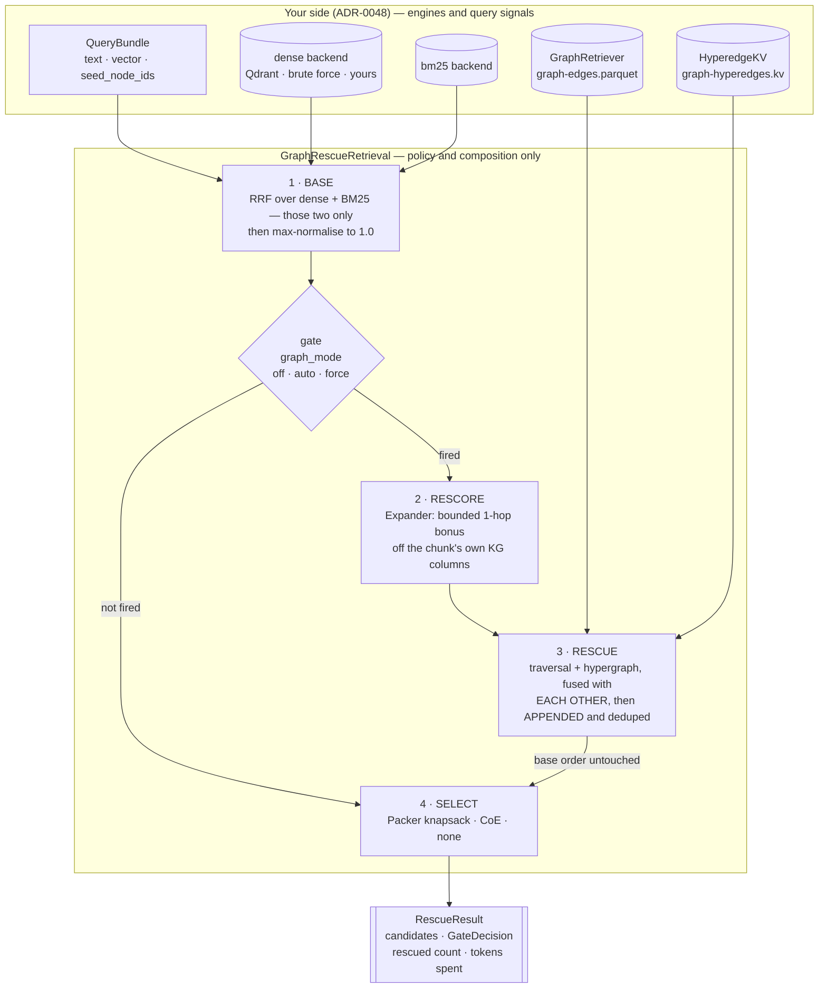

# 5 · Retrieval

*Chapter 4 finished with two directories of files. This chapter turns them back into
answers: what runs at query time, what it costs, and exactly what the measurements do —
and do not — say.*

The export is inert. `corpus.parquet` holds the chunk text, its 768-dim embedding and the
four denormalised KG columns; `bm25-stats.json` + `bm25-postings.parquet` hold the lexical
signal; `graph-edges.parquet` and `graph-hyperedges.kv` hold the graph. Nothing about that
is a retrieval engine, and the framework does not ship one. `latence-retrieval` holds no
index, opens no connection of its own and runs no first-stage search: it composes over
candidates **your** engine returned ([ADR-0048](../adr/0048-retrieval-tooling-is-strictly-stateless.md)).
That constraint is what makes the whole chapter portable — the composition below runs
identically on Qdrant, on a brute-force numpy scan, or on whatever your organisation
already pays for.

There are **zero LLM calls anywhere on this path**. Every signal is a precomputed column, a
graph traversal, or a deterministic solver.

---

## 5.1 · The shape

The production composition is one class —
`latence_retrieval.rescue.GraphRescueRetrieval` — and four phases.



Read the arrow labelled *base order untouched* as the thesis of the chapter. The earlier
design ran graph traversal as one more retrieval leg and RRF-fused it with dense and BM25;
that was measured to *lower* recall on every dataset of the matrix. The components were
fine. The application was wrong, and the fix is an asymmetry: dense and BM25 are peers and
fuse; the graph lanes are not peers and append.

---

## 5.2 · Phase 1 — BASE

Two first-stage fetches at `pool_k: 100` each, fused by Reciprocal Rank Fusion, then
max-normalised.

```python
# packages/latence-retrieval/src/latence_retrieval/rescue.py:666
rankings = [list(ranking) for ranking in (dense, bm25) if ranking]
if not rankings:
    return []
return _unit_scaled(self._fuser.fuse(rankings))
```

`RrfFuser` scores each candidate `Σ wᵢ/(k + rankᵢ)` with `k = 60` — rank position only, no
score magnitude — which is why a cosine list and an Okapi list combine without their
incomparable scales distorting each other. Ties break on ascending `id`, and the emitted
candidate keeps the **first-seen** text/metadata in input-list order. That last detail is
load-bearing and reappears in §5.9.

The max-normalisation (`_unit_scaled`, `rescue.py:1091`) divides every score by the set
maximum. It is strictly monotone, so **the base ordering is unchanged** — it is a change of
units, not of ranking. It exists because the next phase adds *absolute* bonuses: an RRF
score sits near 0.033 at rank 0, so an un-normalised hop bonus of 0.5 would let a single
graph link outvote the entire base list. On the unit scale the base's own rank-to-rank gap
near the head is about 0.016, and the shipped hop bonus is 0.05 — enough to move a
corroborated candidate a few ranks, never enough to vault the head.

Both legs are optional in principle (at least one is required, or construction fails), and
a bundle with no `vector` simply drops the dense leg.

---

## 5.3 · Phase 2 — RESCORE

`Expander` is a plain `CandidateProcessor`: `(query, candidates) → candidates`. It runs
**no graph database**. Everything it needs is already on the chunk, put there by chapter 4's
`enrich` stage:

| Column | What it holds | What the Expander does with it |
|---|---|---|
| `kg_node_ids` | the chunk's own entity node ids | co-mention link; also the doc-derived traversal seeds |
| `neighbor_node_ids` | node ids the chunk's triples reach | 1-hop edge link, checked in **both** directions |
| `kg_node_community` | community id per entity | flat shared-community bonus |
| `kg_node_centrality` | centrality float per entity | `weight × peak centrality` (the per-entity list is reduced to its max) |

It takes the top `seed_top_k` candidates by first-stage score as the graph anchor, then
gives every candidate `hop_weight ×` (number of distinct seeds it is 1-hop-linked to), plus
the optional community and centrality bonuses, and re-sorts. A link is a KG **edge**
(`a.nodes & b.reach` or `b.nodes & a.reach`) **or** a shared entity node (`a.nodes & b.nodes`)
— `expand.py:240`.

The rescue pipeline overrides the Expander's own library defaults with its measured
operating point, which is worth stating because the two differ:

| Knob | `Expander` default | What `GraphRescueRetrieval` passes |
|---|---|---|
| `seed_top_k` | 3 | **5** |
| `hop_weight` | 0.5 | **0.05** |
| `community_weight` | 0.0 (off) | **0.01** |
| `centrality_weight` | 0.0 (off) | **0.05** |

A candidate carrying none of these columns earns nothing and the transform is an
order-preserving no-op. A column that is *present but malformed* fails loudly at the
boundary — the read contract has one home, `latence_retrieval.kg_columns`, and every
consumer (Expander, Packer, seed harvest) runs that same code.

---

## 5.4 · Phase 3 — RESCUE, and why it appends

Two graph lanes run, both anchored on the same seed set:

- **traversal** — `GraphRetriever`, a `RetrievalBackend` declaring `GRAPH`. It asks a
  `GraphSource` for the seeds' bounded neighbourhood (default `max_hops: 2`), resolves
  reached nodes back to chunks through a `GraphDocumentSource`, and scores each chunk
  `seed_score × hop_decay ** h` at its *closest* hop (defaults `1.0` and `0.5`).
- **hypergraph** — `hypergraph_signals` over the emitted `graph-hyperedges.kv`: entry from
  the query's alias n-grams (weight 1.0) and the seed node ids (weight `alpha`), expansion,
  an `s_hyp` prune, two-stage random-walk-with-restart, then a vertex/coverage gate. Retained
  Hyperedges, ordered by descending ρ with an id tiebreak, resolve to chunks through the
  caller's `HyperedgeDocumentSource`.

The seeds come from the query **and** the top first-stage documents — query seeds first, so
the cap trims the weakest anchors rather than an arbitrary set:

```python
# rescue.py:775 — _graph_seeds
seeds: list[str] = list(dict.fromkeys(query_seeds))
seen = set(seeds)
for candidate in base[: self._seed_docs_k]:          # 5
    for node in _node_ids(candidate):                # the candidate's own kg_node_ids
        if node not in seen:
            seen.add(node); seeds.append(node)
return tuple(seeds[: self._seed_node_cap])           # 32
```

The two lanes **are** peers of each other — both are graph reach over the same KG — so RRF
between them is the same legitimate move as dense+BM25 (`rescue.py:798`). What never happens
is fusing that result into the base. This is the mechanism, verbatim:

```python
# rescue.py:1071 — _append_and_dedupe
seen = {candidate.id for candidate in base}
ordered: list[tuple[Candidate, bool]] = [(candidate, False) for candidate in base]
for candidate in rescue:
    if candidate.id in seen:
        continue
    seen.add(candidate.id)
    ordered.append((candidate, True))
    if len(ordered) - len(base) >= cap:               # rescue_cap: 50
        break
return [
    candidate.model_copy(update={
        "score": 1.0 / (k + rank),                    # rank_score_k: 60
        "metadata": {**candidate.metadata, "rescued": rescued},
    })
    for rank, (candidate, rescued) in enumerate(ordered)
]
```

Four invariants live in those fifteen lines:

1. The base list's relative order is **copied unchanged**.
2. A rescue candidate already in the base is **dropped**, never re-ranked to its rescue
   position. Rescue can add, it can never promote.
3. What remains is appended **below the whole base**, capped at 50 — a tail, not a second
   ranking.
4. Every candidate is rescored by its *position* as `1/(60 + rank)`. The score now encodes
   the order instead of competing with it, and it decays in the same slow shape the base
   already had — so a candidate deep in the pool keeps enough value for the packer to
   consider instead of the greedy stalling at a fraction of the budget. The
   `metadata["rescued"]` stamp is what lets a selector, an operator or an evaluation tell
   what the base earned from what the graph carried in.

**Why fusing would be wrong, stated as a mechanism rather than a preference.** RRF is
rank-only. A traversal list is dense at the top by construction — every chunk mentioning a
seed entity scores exactly `seed_score`, ordered by id — so its rank-1 entry is an
*arbitrary* member of a large tie class, and at equal weight it contributes the same
`1/61` as the strongest dense hit. Fusing therefore lets a chunk that merely mentions a
query entity displace a chunk the dense and lexical stages both chose. Appending removes
the competition entirely: the graph can only occupy positions no base candidate wanted.

---

## 5.5 · The gate

Paying for a traversal on a query that does not need one is pure latency, and on a
known-item query it is actively harmful. `graph_mode` decides:

```python
# rescue.py:739 — _decide, graph_mode="auto"
reasons: list[str] = []
if lowered & self._relation_cues:                        reasons.append("relation-cue")
if len(query_seeds) >= self._entity_heavy_seeds:         reasons.append("entity-heavy")
if agreement < self._low_agreement:                      reasons.append("low-agreement")
if confidence < self._low_confidence:                    reasons.append("low-confidence")

navigational = (
    len(words) <= self._navigational_max_words
    and "relation-cue" not in reasons
    and agreement >= self._high_agreement
)
```

| Signal | Fires when | Default |
|---|---|---|
| `relation-cue` | the query carries a relation word (`why`, `between`, `caused`, `depends`, `compare`, …) | the shipped 22-word lexicon |
| `entity-heavy` | the query itself names ≥ *n* linked entities | 2 — one entity is a look-up, two is a question about how they stand to each other |
| `low-agreement` | Jaccard overlap of the dense and BM25 top-*k* ids | top-10 < 0.30 |
| `low-confidence` | dense top-1 score | < 0.60 — the one corpus-dependent knob |
| **veto** `navigational` | ≤ 6 words, no relation cue, and the two routes agree ≥ 0.50 | overrides everything that fired |

`agreement` is Jaccard, and it is `0.0` when *either* list is empty: a route that returned
nothing agrees with nobody, which is a low-confidence signal, not a perfect one
(`top_k_agreement`, `rescue.py:1007`).

`off` and `force` do not erase the policy's opinion — they record what `auto` *would* have
decided (`vetoed_by: "mode-off"`, reason `mode-force`). A mode that threw that away could
not distinguish a gate that is too tight from a lane that is too weak. Every decision comes
back on the result as a frozen `GateDecision`, so the hit rate is a number you report.

**Measured, `graph_mode: auto`, full query sets:**

| dataset | queries | fired | hit rate | `entity-heavy` | `low-agreement` | `relation-cue` | vetoed |
|---|---:|---:|---:|---:|---:|---:|---:|
| vidoseek | 1,142 | 1,132 | 0.9912 | 1,104 | 532 | 67 | 0 |
| ohr_bench | 4,541 | 4,541 | 1.0000 | 4,535 | 2,794 | 652 | 0 |
| uda | 8,583 | 8,583 | 1.0000 | 8,583 | 8,202 | 1,233 | 0 |
| multihop_rag | 2,255 | 2,255 | 1.0000 | 2,255 | 1,340 | 1,049 | 0 |
| wiki2multihop | 12,576 | 12,573 | 0.9998 | 12,575 | 10,504 | 881 | 3 |
| musique | 1,209 | 1,208 | 0.9992 | 1,185 | 1,089 | 64 | 0 |
| hotpotqa | 3,703 | 3,703 | 1.0000 | 3,701 | 2,906 | 359 | 0 |

The honest reading: on **benchmark** corpora the gate is nearly a no-op. These are QA
datasets — every query names entities and asks a relation — so `entity-heavy` fires almost
everywhere and three queries in 33,000 were vetoed as navigational. The gate is built for
the traffic mix a real deployment has, where "acme msa 2024 pdf" and "q3 revenue" are a
large share of queries; this matrix simply contains none of them. Do not read a 100% hit
rate as evidence the gate works — read it as evidence the corpus does not exercise it, and
measure your own.

---

## 5.6 · Phase 4 — SELECT

The union is handed to one of three selectors. Two of them spend a token budget, which is
the only place in the pipeline where a knob maps directly onto an LLM bill.

**`packed` — the knapsack QKP (`Packer`).** Maximises

```
Σ value(i) − redundancy_weight · Σ similarity(i, j)     subject to  Σ tokens(i) ≤ budget
```

by a deterministic greedy over marginal-value-per-token, ties on ascending `id`. `value` is
the max-scaled first-stage score plus `pack_centrality_weight: 0.25 ×` the chunk's peak
`kg_node_centrality` — **the one graph feature that reaches selection as a value rather than
as an ordering**. Redundancy precedence is: an explicit `similarity_key` entry, else equal
`cluster_key`, else lexical Jaccard over the texts.

The greedy stops when every remaining marginal is ≤ 0. Measured, that stranded ~45% of a
10,000-token budget — and on a retrieval bench unspent budget is unrecovered recall. Hence
the shipped `fill: "backfill"`:

```python
# packages/latence-retrieval/src/latence_retrieval/pack.py:434
if self._fill == "backfill":
    by_value = sorted(
        (index for index in range(len(items)) if index not in chosen_set),
        key=lambda index: (-values[index], items[index].id),
    )
    for index in by_value:
        if costs[index] > remaining:
            continue
        chosen.append(index); chosen_set.add(index); remaining -= costs[index]
```

Backfill **never touches the greedy phase's picks or their order** — it only appends into
budget the QKP declined to spend. It is safe precisely because the pool is already
query-conditioned by the first stage: these are not arbitrary chunks, they are the ones two
retrievers already voted for. `fill: "stop"` restores pure QKP semantics if you want the
precision-per-token point.

**`coe` — chain-of-evidence (`coe.select`).** CoE selects *Hyperedges*, not arbitrary chunks,
so it cannot rank the union directly. The composition therefore lets CoE decide which of the
**rescue** candidates are evidence worth budget, and fills the rest with the base in its own
rank order:

```python
# rescue.py:928 — _coe_select
for candidate in pool:
    if candidate.metadata.get("rescued", False) and candidate.id not in allowed:
        continue
    cost = max(_TOKENS.count(candidate.text), 1)
    if spent + cost > budget:
        continue
    selected.append(candidate); spent += cost
```

Choosing `coe` without a configured hypergraph lane is a loud error at construction *and* at
`select()`: a pipeline that never propagated any Hyperedges has nothing for it to buy.

**`none`** returns the ranked union unchanged — for callers running their own downstream
selection, and for like-for-like `recall@k` against plain rankings.

Token cost is measured by a `TokenCounter` seam. The default `HeuristicTokenCounter` is
pure-Python (word pieces plus standalone punctuation) and needs no download;
`TiktokenCounter` gives an exact count against a named encoding, and **no encoding is
pinned** — you must name one ([ADR-0012](../adr/0012-permissive-only-reference-providers-gemma-opt-in.md)).

---

## 5.7 · Running it

### The three entry points

`run(bundle)` is the one-shot production call. Underneath, the pipeline is two halves, and
`run(bundle)` **is** `select(bundle.text, retrieve(bundle))`, byte for byte:

```python
retrieval = pipeline.retrieve(bundle)        # expensive: 2 fetches, traversal, propagation
for budget in (4_000, 10_000, 16_000):
    result = pipeline.select(bundle.text, retrieval, budget=budget)   # cheap, pure
coe = pipeline.select(bundle.text, retrieval, selector="coe")         # same union
```

The split is what makes a budget or selector A/B honest *and* affordable: every operating
point is settled against the identical candidate union, so the comparison measures the
selector rather than *N* slightly different retrievals. `RescueRetrieval` — the handoff — is
frozen and carries `base`, `union`, `gate`, `rescued` and the hypergraph `signals` (which is
exactly why the CoE selector can still work after the split).

### Config, grouped by phase

Every default below is the measured operating point. Unknown keys are rejected at
construction against `_CONFIG_KEYS` (`rescue.py:147`), so a typo is a loud error rather than
a silently-ignored knob.

| Phase | Keys (default) |
|---|---|
| gate | `graph_mode` (`auto`), `relation_cues` (shipped lexicon), `entity_heavy_seeds` (2), `agreement_k` (10), `low_agreement` (0.30), `high_agreement` (0.50), `low_confidence` (0.60), `navigational_max_words` (6) |
| base | `pool_k` (100) |
| rescore | `seed_top_k` (5), `hop_weight` (0.05), `community_weight` (0.01), `centrality_weight` (0.05) |
| rescue | `seed_docs_k` (5), `seed_node_cap` (32), `rescue_cap` (50), `rank_score_k` (60), `hyperedge_kv_path` (`None`) |
| select | `selector` (`packed`), `budget` (10,000 packed / 16,000 coe), `select_pool_k` (100), `pack_centrality_weight` (0.25), `similarity_key` (`redundancy`), `fill` (`backfill`) |

The flat reference table, the wizard mapping and the `campaign.yaml` block live in the
[graph-rescue retrieval guide](../guides/graph-rescue-retrieval.md).

### The serving path, and what makes it equivalent to the benchmark path

The benchmark's dense leg is a brute-force cosine over a resident matrix. Production serves
it through Qdrant. **Neither the composition nor the phases change** — both are the same
`GraphRescueRetrieval`, and the only variable is which object satisfies the
`RetrievalBackend` protocol:

```python
served = QdrantBackend({
    "collection": "wiki2multihop-dot", "capabilities": ["dense", "filter"],
    "dimension": 768, "url": "http://localhost:6333",
    "search_params": {"hnsw_ef": 512},
})
pipeline = GraphRescueRetrieval(config, dense=served, bm25=..., graph=..., ...)
```

Two details make the substitution total rather than approximate. `QdrantBackend` reads the
chunk text from payload key `content` and the corpus identity from payload key `record_id`
— the framework's own export column names, which `latence-sink-qdrant` writes verbatim — so
`Candidate.id` is still the *corpus* id. Everything downstream (the fuser's dedup,
append-and-dedupe, hyperedge→chunk resolution, gold scoring) keys on that. A payload missing
the configured key is a loud `BackendSearchError`, never a silently empty `Candidate.text`.

Measured head-to-head, same queries, same gold, `selector: "none"` so nothing masks a
first-stage delta (`benchmark/serving/results/*.summary.json`):

| dataset | metric | brute-force reference | served via Qdrant | delta |
|---|---|---|---|---|
| wiki2multihop (12,576 q) | R@10 | 0.708129 | 0.707851 | −0.000278 |
| wiki2multihop | docR@10 | 0.718333 | 0.718054 | −0.000278 |
| multihop_rag (2,255 q) | R@10 | 0.375756 | 0.375756 | 0.0 |
| multihop_rag | docR@10 | 0.854176 | 0.854176 | 0.0 |

Dense-lane ANN recall@10 against the exact top-10 is 0.999491 / 1.0; gate decisions agree on
100% of queries on both. Served latency for the *whole* pipeline, single node over HTTP, one
query at a time: wiki2multihop median 82.6 ms / p95 213.4 ms; multihop_rag median 42.2 ms /
p95 83.1 ms. `hnsw_ef` is the knob — at Qdrant's default it drops to R@10 −0.0125 on a
200-query wiki2multihop sample, at 512 it is exact to the fourth decimal. Full runbook:
[serving with Qdrant](../guides/serving-qdrant.md).

---

## 5.8 · How it was measured

### The leg roster

Ten legs over seven datasets, 70 cells, every query, no `--limit`. Three families, and the
family determines whether a leg is on the Δ chain (`benchmark/s5/legs.py:208`):

| Leg | Family | What it computes | What it isolates |
|---|---|---|---|
| `dense` | ladder | brute-force cosine over `corpus.parquet:embedding` (content **+** the chapter-4 context header) | the dense floor |
| `bm25` | ladder | `dense` ⊕ BM25, equal-weight RRF | what the lexical signal adds — the real hybrid baseline |
| `kg` | ladder | + `GraphRetriever` traversal as a **fused** peer | the graph as a co-equal RRF list |
| `hyperedges` | ladder | + `hypergraph_signals` chunks as a fused peer | the hypergraph lane, same wrong application |
| `coe` | ladder | + `coe.select` output as a fused peer, budget 4,000 | chain-of-evidence as a fused list |
| `packer` | ladder | fuses what `coe` fuses, then `Packer` at budget 4,000 | selection *on top of* the fused-graph ranking |
| `dense_content_only` | ablation | `dense` re-run against `corpus-vectors-content-only.parquet` | **the chapter-4 context header**, alone. Only the corpus side changes — queries carry no header, so both legs rank the identical query vectors |
| `graph_rescue` | rescue | the shipped component, `selector: "none"` | the ranked union — comparable to the ranking rungs at `recall@k` |
| `graph_rescue_packed` | rescue | same retrieval, `selector: "packed"`, headline 10,000 | selection vs `packer`: same selector, correct application |
| `graph_rescue_coe` | rescue | same retrieval, `selector: "coe"`, headline 16,000 | the recall-side selector |

The four ablations that matter:

- `dense_content_only` **vs** `dense` — the context header's contribution, which would
  otherwise be an invisible advantage folded into every dense number, and an *uneven* one:
  the three S3 corpora carry populated headers while the reused musique/hotpotqa exports
  carry `context_header: null` on every row. (Those two are recorded
  `status: "missing-inputs"` for this leg — the sidecar was never built — never as a zero.)
- `kg` / `hyperedges` **vs** `bm25` — the graph signals applied as fused peers. This is the
  regression the whole architecture exists to remove, and it is kept in the table rather
  than deleted.
- `packer` **vs** `graph_rescue_packed` — the *same* `Packer` over two different candidate
  unions. Isolates selection from the ranking it selects over.
- `graph_rescue` **vs** `bm25` — see §5.9, where this one gets its exact reading.

A rescue leg refuses to run through the ladder's fuse path at all
(`legs.py:779`): returning `[dense, bm25]` for it would be the base stage wearing the rescue
leg's name, and the cell would read as "graph rescue bought nothing".

### How the metrics are actually computed

Gold is a **set of chunk ids**, not one relevant document, because that is what the datasets
provide after resolution — a 2Wiki question has two supporting paragraphs, a ViDoSeek
question a page's worth of chunks, a MultiHop-RAG question up to four articles.

```python
# benchmark/s5/metrics.py:54
def recall_at_k(ranked, gold, k):
    if not gold:
        return 0.0
    return len(gold & set(ranked[:k])) / len(gold)
```

- **`recall@k`** is set recall, so a query whose page split into three chunks is *not*
  counted as solved by retrieving one of them. The published ViDoSeek/OHR-Bench baselines
  score at page level — the same quantity when a page is one chunk, and a strictly harder
  one when it is not.
- **`nDCG@10`** uses binary gains with the ideal ranking capped at `min(|gold|, 10)`, so a
  query with 30 gold chunks cannot score below one with 2 purely for having more gold.
- **`doc_recall@{5,10}`** is the same set recall after both sides are deduplicated to source
  documents, **first occurrence wins** — a document takes the position of its *best*-ranked
  chunk. A chunk with no known document is dropped rather than mapped to a placeholder,
  because a placeholder would merge every unknown chunk into one fake document and inflate
  the number in the direction nobody checks. It exists because the de-facto comparison line
  (HippoRAG-2 reports passage recall@5) is a document quantity, and ten retrieved chunks
  cover far fewer than ten distinct documents.
- **`chain_coverage@10`** is the fraction of a gold chain's slots with ≥ 1 chunk in the
  top-10; **`full_chain_hit@10`** is 1 only when *every* slot is covered — the metric that
  distinguishes a multi-hop retriever from a lucky single-hop one. Both are `None` where the
  dataset publishes no chain, never 0.0.
- The document view is derived **in the harness, from the export**, not by the legs, so every
  leg's number is deduplicated by the identical map (`run_matrix.py:505`).
- Latency for a rescue curve point is `retrieve_ms + this budget's select_ms` — the
  retrieval is paid once per query, so no curve point looks free.

### The determinism contract, and the finding behind it

```python
# benchmark/s5/run_matrix.py:159
THREADS_REFUSAL = (
    f"pin {' = '.join(THREAD_VARS)} = {PINNED_THREADS} (the dense leg's BLAS gemv and the query "
    "embedder reassociate their float sums per thread count, which changes rankings: measured, "
    "33/1209 musique queries get a different dense pool at 4 threads vs 1)."
)
```

The harness refuses to run unless `PYTHONHASHSEED=0` **and** `OMP_NUM_THREADS`,
`OPENBLAS_NUM_THREADS`, `MKL_NUM_THREADS` are all `1`, at the API entry so the campaign
stage is bound by it too.

That second half joined the contract after a measurement, and it is worth the space because
it generalises to anyone benchmarking retrieval. Comparing the pre-optimisation matrix
against the re-run, 39 of 46 comparable cells were identical on every quality number and
**7 moved in the fourth decimal**. The obvious hypothesis — that the vectorised BM25
reassociated float summation and tipped a value on a rounding boundary — was tested and
**killed**:

1. *The arithmetic cannot reach it.* musique/bm25's unrounded `recall@10` is
   0.3404457170718723, which sits 4.283e-06 below the 0.34045 rounding boundary while the
   metric's own summation error is 1.1e-15. Six orders of magnitude short. And
   `tokens_packed_mean` is `round(S/N, 1)` over an **integer** sum, so float accumulation
   cannot move it at all — the vidoseek cell that moved requires ≥ 170 tokens of genuinely
   different packed content.
2. *The ranking code was byte-identical between the two sweeps.* Zero functional diff over
   `DenseBackend`, `Bm25Backend`, `_Bm25TermMatrix`, `fuse_signals`, `POOL_K`, `_tokenize`,
   `Runner`, `fuser.py`, `bm25.py`, `metrics.py`, `goldmap.py`, `embed.py`.
3. *The variable was the environment.* Flipping only the thread count on current head
   reproduces it exactly:

   | threads | unrounded `recall@10` | reported | unrounded `ndcg@10` | reported |
   |---|---|---|---|---|
   | 1 | 0.3404457170718723 | 0.3404 | 0.4161434108235836 | 0.4161 |
   | 4 | 0.3405835720484370 | 0.3406 | 0.4161918995551152 | 0.4162 |

   Same code, same corpus, same 1,209 queries: 33 get a different dense pool, 4 a different
   top-10 membership, and exactly **one** (`musique-2hop__67660_158861`, `|gold| = 6`) a
   different gold-hit count. `1/(1209 × 6) = 1.37855e-04` — matching the observed difference
   to the digit.

So: a real ranking change, not a regression, and not caused by the optimisation work. The
correct reading is 39 of 46 exact and 7 inside the harness's own reproducibility floor of
roughly ±1 query in 1,209 — a floor that was previously **undeclared**. A benchmark that
lets the thread scheduler edit its results is not a benchmark, and the fix belongs in the
harness rather than in a note asking operators to remember. Twenty further cells are
reported as **not comparable** because the pre-optimisation run measured them under
`--limit 1000` and the re-run measured them whole (hotpotqa 1,000 → 3,703, uda → 8,583,
wiki2multihop → 12,576); a recall over a different query set is a different quantity, and
calling it either a pass or a failure would be a lie about what was measured.

---

## 5.9 · What was measured

### Recall against the baselines

`recall@10`, full query sets, no limit. `dense` is the baseline the work had to beat;
`bm25` is the hybrid rung, included because it is the number a sceptical reader will ask
for.

| dataset | `dense` | `bm25` (hybrid) | `packer` (the old floor) | **`graph_rescue`** | vs `dense` | vs `bm25` |
|---|---|---|---|---|---|---|
| vidoseek | 0.9466 | 0.9705 | 0.7538 | **0.9726** | +0.0260 | +0.0021 |
| ohr_bench | 0.5890 | 0.6609 | 0.2793 | **0.6589** | +0.0699 | −0.0020 |
| uda | 0.0594 | 0.1261 | 0.0266 | **0.1276** | **+0.0682 (2.1×)** | +0.0015 |
| multihop_rag | 0.3328 | 0.3772 | 0.2028 | **0.3759** | +0.0431 | −0.0013 |
| wiki2multihop | 0.6753 | 0.7018 | 0.5446 | **0.7096** | +0.0343 | +0.0078 |
| musique | 0.3353 | 0.3404 | 0.2500 | **0.3404** | +0.0051 | 0.0000 |
| hotpotqa | 0.5576 | 0.5786 | 0.4103 | **0.5786** | +0.0210 | 0.0000 |

**Graph rescue beats the dense baseline on all seven datasets**, and the regression the
original table recorded is gone: no leg that appends graph evidence lands below dense.
Document recall says the same — `doc_recall@10` for `graph_rescue` is vidoseek 0.9956,
ohr_bench 0.9738, uda 0.4466, multihop_rag 0.8551, wiki2multihop 0.7198, musique 0.6068,
hotpotqa 0.8119, dense-or-better everywhere.

Against the *hybrid* rung the picture is smaller and two-sided, and pretending otherwise
would be marketing. Graph rescue wins on three datasets, ties on two, and loses in the third
decimal on two. It also trades head precision for depth on some corpora: on ohr_bench
`nDCG@10` is 0.5849 against `bm25`'s 0.6137 and `recall@1` 0.2487 against 0.2796, while on
wiki2multihop it wins `full_chain_hit@10` 0.4222 against 0.4076. The Expander lifts
graph-corroborated evidence into the top-10 and in doing so reshuffles the top-1.

### What the recall numbers actually attribute — read this before quoting them

This follows from the code and is verifiable in one run, and it changes how the table above
should be read.

With `pool_k: 100`, a dense leg that returns a full pool makes the fused base **100–200
candidates** long. `_append_and_dedupe` places the entire base first, so the first rescued
candidate sits at rank ≥ 100. Two consequences:

- For `graph_rescue` (`selector: "none"`) the ranked list *is* the union in that order, so
  **no rescued candidate can appear in any top-10**. Every `recall@k (k ≤ 10)` and
  `nDCG@10` in the rescue rows is a measurement of the **base**: dense + BM25 fused,
  max-normalised, and rescored by the Expander off the KG columns.
- `select()` truncates to `union[:select_pool_k]` (`rescue.py:878`) with `select_pool_k: 100`,
  so on these corpora the selector's pool is also entirely base.

Both are directly observable — with the shipped defaults and 100-candidate engines,
`retrieve()` returns a 200-long base, a 250-long union, and the first `rescued` stamp at
index 200; `select()` selects nothing marked `rescued`.

That yields a clean attribution nobody has to take on trust. When the gate does *not* fire,
the base is plain equal-weight RRF over `[dense, bm25]` with `k = 60` — **bit-identical to
the `bm25` ladder rung**, since max-normalisation is monotone. So:

> **`graph_rescue` − `bm25` is exactly the Expander rescore**, on the queries where the gate
> fired: +0.0078 (wiki2multihop), +0.0021 (vidoseek), +0.0015 (uda), 0.0000 (musique,
> hotpotqa), −0.0013 (multihop_rag), −0.0020 (ohr_bench).

And it explains the rest of the matrix without any further assumption. `graph_rescue_coe`
reproduces `graph_rescue` **exactly** on six of seven datasets, and `graph_rescue_packed` on
four, because the selectors only ever *drop* from a pool whose head is the base — the union's
`1/(60+rank)` scores are strictly decreasing, so the packer's `(-score, id)` sort preserves
relative order and can never promote. Where they differ (vidoseek, ohr_bench, uda) the budget
binds, which §5.10 measures directly.

So the traversal and hypergraph lanes are **architecturally live and measurably inert at
k = 10 on this matrix**. What they cost is latency.

### And what they would buy, now measured: almost nothing

The configurations that would un-inert them — `select_pool_k > |base|`, a `k` beyond the
base's length, a narrower `pool_k`, or interleaving instead of appending — were run in ticket
06 over three datasets, against a `base` arm that reproduces this matrix's `graph_rescue`
cells to four decimals. **All four are refuted, and none of them was the binding constraint.**

The bound that settles it is an oracle: promote every rescued gold chunk to the front of the
list, which no shippable policy can beat.

| dataset | rescue-only gold per query | queries with any | **ceiling Δ recall@10** | perfect rerank of the base |
|---|---|---|---|---|
| multihop_rag (2,255) | 0.142 | 9.8% | **+0.0056** | **+0.3724** |
| wiki2multihop (2,500) | 0.021 | 2.0% | **+0.0077** | **+0.0905** |
| vidoseek (1,142) | **0.000** | **0%** | **+0.0000** | +0.0244 |

On vidoseek the graph lanes reach **not one** gold chunk the base missed. And the same oracle
pointed at the base alone — a perfect rescore of candidates dense+BM25 *already* retrieved — is
worth 66× and 12× the graph's entire ceiling on the two multi-hop corpora. The base retrieves
87% of multihop_rag's gold into its top 100 and ranks 38% into its top 10: **a ranking problem
wearing a reach problem's clothes.**

Two results worth keeping out of that:

* **§5.4's append-not-fuse choice is confirmed, not merely defended.** Run as a continuum, RRF
  weight on the graph lane is monotonically harmful — −0.0187 at `w=0.25`, −0.1121 at `w=1.00`
  on multihop_rag — and no weight is small enough to help without being small enough to do
  nothing. Fusing destroys the ranking; appending contains it. That containment is real.
* **The Expander should not inherit the win.** `graph_rescue` − `bm25` is exactly the Expander
  (above), and it is recall-neutral and **nDCG-negative on four of the five datasets where it
  acts**. It trades head precision for a third-decimal recall gain.

The right claim from these numbers is therefore:

> *Applied as rescue, the graph never lowers recall — which fusing it demonstrably does, by up
> to −0.11. But the traversal and hypergraph lanes reach almost nothing the base missed, and no
> configuration of `select_pool_k`, `k`, `pool_k` or fusion weight converts that into a
> measurable win. At 221–538 ms/query against BM25's 1.1–8.3 ms, they do not earn their
> latency. The next unit of retrieval quality is a rescore over the base's own top-100.*

Full design, arms and stop rule:
`issues/wayfinder-enterprise-serving/tickets/06-graph-inertia/REPORT.md`.

### Latency

64 cells carry a comparable pre/post latency pair (median of per-query wall clock).

| | |
|---|---|
| median speedup | **9.83×** |
| maximum | 463.8× (`ohr_bench__bm25`, 1,303 → 2.81 ms) |
| the one at scale | `uda__graph_rescue` **6,648 → 646 ms (10.3×)** |
| | `uda__hyperedges` 5,362 → 79.6 ms (67×), `uda__kg` 859 → 37.2 ms (23×) |
| | `wiki2multihop__bm25` 2,058 → 8.3 ms (247×), `ohr_bench__kg` 1,301 → 3.3 ms (395×) |
| cells that got **slower** | 5, all reported: `vidoseek__graph_rescue_packed` +15.5 ms, `graph_rescue_coe` +10.8 ms, `graph_rescue` +1.7 ms (≈3% on a ~470 ms baseline), and two sub-2 ms dense cells |

`uda__graph_rescue_coe` is the clearest single result: it has **no pre-optimisation
counterpart**, because on the old code it never finished at all across 10+ hours. It now
completes, at 664.6 ms median over 8,583 queries.

Where the time went, per the code that changed: BM25 became a term-major CSR built once per
export, so a query is one sparse mat-vec instead of a Python loop over the ~92% of the corpus
that holds at least one query term. The hypergraph reader gained a per-file process-cached
index (int-indexed postings CSR + incidence) instead of a binary search plus JSON decode per
postings row — at 677k hyperedges that was ~4.7M key comparisons and ~230k JSON decodes per
query. Both fast paths are pinned byte-identical to the slow ones by test and by a full
real-query parity run.

Current shape at rest, `graph_rescue` median / p95 in ms, in-process brute-force dense:
musique 114.6 / 149.8 · hotpotqa 144.5 / 179.3 · wiki2multihop 240.9 / 451.7 · ohr_bench
441.0 / 584.4 · vidoseek 467.0 / 550.5 · multihop_rag 509.6 / 642.8 · uda 646.0 / 1,026.0.
Served through Qdrant the numbers are *lower* on the large corpus (wiki2multihop 82.6 ms
median), because the brute-force reference only looks cheap while a 57,812 × 768 matrix is
resident in the process.

---

## 5.10 · The budget curve

A selection stage optimises *best context within a budget*, so a single `recall@10` is the
wrong shape of number for it. The curve is the native protocol, and it is settled against
**one retrieval per query** through `select()`, so it varies the budget and nothing else.

vidoseek, `graph_rescue_packed`, 1,142 queries — the dataset where the packed leg looks
worst (0.8424 against the unpacked 0.9726) and therefore the one worth reading:

| budget | `recall@10` | `doc_recall@10` | `nDCG@10` | tokens actually packed |
|---:|---|---|---|---:|
| 2,000 | 0.2747 | 0.9387 | 0.2790 | 1,920.5 |
| 4,000 | 0.5599 | 0.9921 | 0.5276 | 3,930.6 |
| 8,000 | 0.7545 | 0.9947 | 0.6751 | 7,936.1 |
| 10,000 | 0.8424 | 0.9947 | 0.7338 | 9,931.8 |
| 16,000 | 0.9631 | 0.9956 | 0.8063 | 15,931.4 |
| 24,000 | 0.9696 | 0.9956 | 0.8110 | 23,922.4 |
| **32,000** | **0.9726** | 0.9956 | **0.8138** | 31,912.8 |

Three things are visible, and none of them is an opinion.

1. **The packer spends what it is given** — 9,932 of 10,000, 31,913 of 32,000. That is
   backfill working; the pre-backfill greedy left ~4,500 tokens of a 10k budget unspent.
2. **At 32k the packed leg equals the unpacked leg exactly** — 0.9726 recall@10 and 0.8138
   nDCG@10, to the digit. The ceiling is the budget, not the packer. vidoseek is a
   page-image corpus with long pages and its answers do not fit in 10,000 tokens.
3. **`doc_recall@10` never drops below 0.9387, even at a 2,000-token budget.** The right
   *document* is found at every budget; what a small budget truncates is the chunk-level
   evidence inside it. If your downstream consumer cites documents, a 2k budget costs you
   almost nothing; if it quotes spans, it costs you two thirds of your evidence.

The CoE curve behaves differently, and the difference is why the two selectors carry
different headline budgets. multihop_rag, `graph_rescue_coe`, 2,255 queries:

| budget | `recall@10` | `doc_recall@10` | tokens packed |
|---:|---|---|---:|
| 2,000 | 0.2016 | 0.5303 | 1,950.9 |
| 4,000 | 0.3401 | 0.6840 | 3,950.3 |
| 8,000 | 0.3759 | 0.8157 | 7,946.8 |
| 10,000 | 0.3759 | 0.8403 | 9,947.9 |
| **16,000** | 0.3759 | **0.8534** | 15,944.4 |
| 24,000 | 0.3759 | 0.8551 | 23,935.8 |
| 32,000 | 0.3759 | 0.8551 | 31,916.7 |

`recall@10` saturates at 8k because — per §5.9 — the top ten is base and the budget stops
binding there. **Document** recall keeps climbing to 24k, which is the quantity CoE is
buying: more of the evidence set, deeper in the list. Hence the headlines: `SELECT_BUDGET =
10_000` for the knapsack (which saturates its greedy phase around 5.5k and backfills the
rest) and `COE_SELECT_BUDGET = 16_000` for CoE, where the spend still buys recall. Each
headline is a member of the curve, so the two can never disagree.

Two corpora show the other end of the behaviour: on musique and hotpotqa the CoE spend
plateaus at ~4,281 and ~4,119 tokens whatever the budget, because the whole union costs less
than the budget. An unspent budget there is not a failure — it is the selector correctly
declining to invent context.

---

## 5.11 · What this means for a deployment

**It augments an engine, it does not replace one.** There is no index to operate, no server
to run, no state to back up. `GraphRescueRetrieval` accepts your `RetrievalBackend` and holds
nothing between queries — identical inputs always yield an identical result. The seam is a
structural `Protocol`, so an adapter is `capabilities` plus `search(query)`; `QdrantBackend`
is the shipped reference and `FakeBackend` the faithful offline fake, so the seam has never
had a single implementation. Capabilities are declared **honestly**: the reference Qdrant
adapter serves `{dense, sparse, filter}` and refuses `bm25`/`multivector` at construction
rather than silently degrading.

**The token budget is a direct line item.** `budget` is the number of context tokens per
query you hand an LLM, and `tokens_packed` on every result is what was actually spent. On
vidoseek the same pipeline delivers `doc_recall@10 ≥ 0.9387` at 1,920 tokens or
`recall@10 = 0.9726` at 31,913 — a 16× cost range over one config value, measured on your own
corpus with `retrieve()` once and `select()` seven times. Nothing in the retrieval path
itself calls a model, so that budget *is* the marginal cost.

**Latency at enterprise scale.** The 220k-chunk `uda` corpus runs the full composition —
dense + BM25 + gate + expander + 2-hop traversal + hypergraph propagation + union — at 646 ms
median, 1,026 ms p95, single-threaded, on a 5.1-core cgroup. Served through Qdrant on the
57,812-chunk corpus it is 82.6 ms median / 213.4 ms p95 over HTTP, one query at a time, with
no batching. Set `graph_mode: off` and you pay for dense + BM25 + fuse and nothing else; the
gate is how you pay for the graph only on the queries that plausibly need it.

**Provenance survives to the answer.** `Candidate.id` is the corpus `record_id`, preserved
across the fuser's dedup, the append-and-dedupe, the packer's selection and the Qdrant
payload round-trip. That row carries `provenance.document_id`, `char_start`/`char_end` and
`page_start`/`page_end` in the parent document's assembled-markdown coordinates, plus
`page_slice` and `offset_map` so a sub-chunk offset resolves to its *true* original page — not
a lower bound. Every retrieved item is therefore citable back to a source span in a named
file, which is usually the difference between a demo and something an auditor accepts.

**Determinism is not aspirational.** No randomness anywhere on the path; every tie in every
component breaks on ascending `id`; the gate returns its reasons; the selector returns its
spend. The one caveat is the one §5.8 measured: floating-point summation order is part of the
run's identity, so pin your BLAS threads before you compare two numbers.

---

## Closing the loop

Five chapters, one through-line: **a folder of files becomes a corpus and a graph that are
the same artifact, and that identity is what query time spends.**

*What the graph bought.* Not a new retriever — a set of columns and sidecars that make
graph-shaped operations cheap at query time. The 1-hop projection onto every chunk turns
graph-aware rescoring into a pure metadata operation on candidates already in hand, so it
runs on any vector store with no graph database in the path, and it is worth up to +0.008
`recall@10` over a strong hybrid baseline. The traversal leg and the hyperedge sidecar are
the mechanism by which a document the first stage never returned can enter a result at all —
the thing a post-fusion rescorer structurally *cannot* express. And the headline number is
really the negative one: applied as rescue rather than as fusion, the graph stopped lowering
recall, on all seven datasets.

*What it cost.* Two corpus-wide stages that see everything at once, a second export, and a
query-time budget: roughly 600 ms per query at 220k chunks single-threaded, 80 ms served
through an ANN engine at 58k. Plus the discipline: a determinism contract strict enough to
refuse to run, and a benchmark honest enough to publish the seven cells that moved in the
fourth decimal and the twenty it declined to compare at all.

*What to do next.*

- **Replace something.** Every stage in chapters 1–4 and every engine in this one sits behind
  a structural `Protocol`. The exact input shape, carrier type and alternative Providers of
  every stage are generated from the source into
  [`docs/reference/stage-contracts.json`](../reference/stage-contracts.json) and rendered as
  the [stage contract reference](../reference/stage-contracts.md) — that file, not any prose
  on this site, is the authority on I/O. Then run the
  [Provider conformance suite](../CONFORMANCE.md): it drives every registered Provider through
  its Capability's case and checks contract adherence (C1), graceful typed failure (C2),
  recorded and permissive-or-opt-in licensing (C3), declared determinism (C4), device honesty
  (C5) and no PII leakage (C6). A Provider for a Capability with no case fails the suite
  loudly rather than skipping silently. Swapping a Provider cannot break the flow; what it
  *can* change is quality, and that stays yours to measure.
- **Run it on your own corpus.** [Quickstart](../quickstart.md) for a green pipeline,
  [running the campaign](../guides/benchmark-campaign.md) to reproduce this matrix, and
  `PYTHONHASHSEED=0 OMP_NUM_THREADS=1 OPENBLAS_NUM_THREADS=1 MKL_NUM_THREADS=1
  python -m benchmark.s5.run_matrix --datasets all --legs all` to re-measure it. Cells are
  cached; `--force` re-measures.
- **Deploy it.** [Graph-rescue retrieval](../guides/graph-rescue-retrieval.md) for the config
  surface and the wizard mapping, [serving with Qdrant](../guides/serving-qdrant.md) for the
  verified path from "pipeline finished" to "queries served".
- **Argue with it.** The reasoning, with its alternatives and its falsifiers, is in
  [the deep dive](../DEEP-DIVE.md) and the [decision log](../adr/index.md). The measurements
  are in [the benchmark pages](../BENCHMARKS.md) and in `benchmark/sota-campaign/`, cell by
  cell, including the ones that did not go our way.

---

← [4 · Enrichment and export](04-enrichment-and-export.md) · [Back to the index](index.md)
