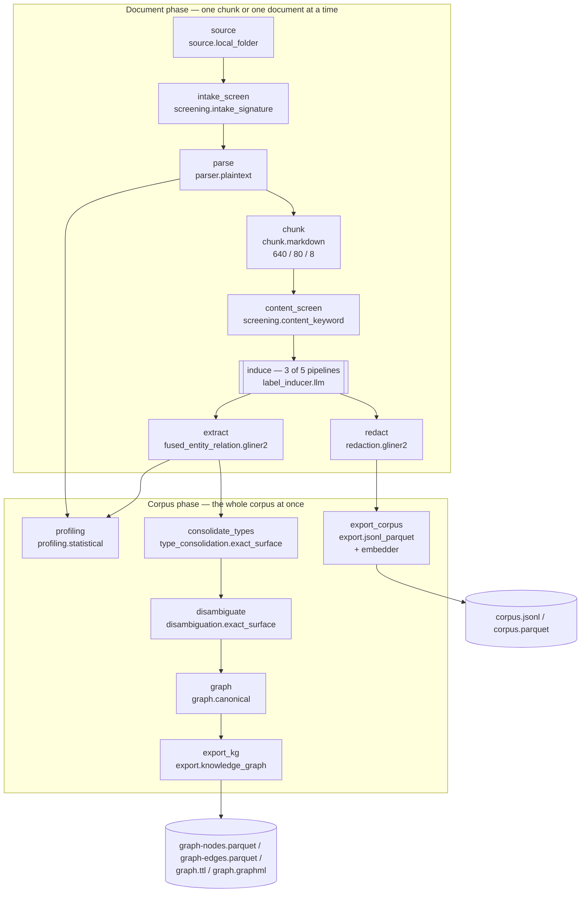

# Pipeline anatomy — the through-line

*One folder of messy files becomes a corpus you can load **and** a knowledge graph whose every
edge can be traced to its source. This page is the spine: the whole pipeline, end to end, in one
read. Each stage gets a sentence or two here and a chapter of its own underneath.*

Everything below is one concrete stack: the pipeline the benchmark campaign generates for each of
its corpora. The generator is
`packages/latence-benchmark/src/latence_benchmark/campaign/s3_lib.py`
(`generate_pipeline_yaml`), and the stage names, Providers and config values on this page are
read out of it and out of the Providers it names. Where a doc and the code disagreed, the code
won and the doc was corrected.

The campaign itself ran in August 2026, on an earlier form of this pipeline that had three more
parts: Context Enrichment, hyperedges with graph features, and a BM25 export. They were removed by
[ADR-0068](../adr/0068-query-time-retrieval-tooling-is-removed-embedders-stay-only-as-a-resolution-signal.md).
The five pipeline files committed under `benchmark/sota-campaign/stages/s3-pipeline/pipelines/`
are the record of that run and still name those parts, so the current code rejects them; the
generator emits the shape described here. Every count on this page that comes from the campaign
is marked as a record of that run.

---

## The through-line, in one paragraph

A folder of files is enumerated and each file is content-addressed and stamped with
provenance. Anything oversized, spoofed or zip-bombed is quarantined *before* it is parsed.
What survives is turned into markdown — by a plain byte decoder if it is born-digital, by a
served vision-language model if it is a scan or a page image — and split into overlapping,
offset-preserving chunks that can still name the exact page and character range they came
from. Each chunk is screened again, optionally given its own small induced label schema, and
run through one model that extracts entities *and* the relations between them in a single
pass; a second model of the same family finds PII. Then the pipeline crosses a line: from
here on it sees the whole corpus at once. It canonicalises the drifted type vocabulary,
resolves mentions into single entities, and assembles an evidence-linked graph of nodes and
edges. Two exports fall out: a knowledge graph as portable files, and a corpus whose rows carry
the masked chunk text, its provenance and, when an embedder is wired, a dense embedding. The
pipeline ends there. What loads those files, and how it queries them, is outside the framework.

The corpus and the graph are one artifact, not two. A graph node lists the ids of the mentions
that were merged into it, each mention record names the chunk it was found in
(`chunk_record_id`) and carries its own page and character offsets, and that chunk id is the
`record_id` of a corpus row. So any node or edge can be walked back to the rows, pages and
character ranges that justify it.

---

## The DAG

The generated pipelines are one shape. For a corpus whose schema is hand-authored
(`multihop_rag`, `wiki2multihop`) it has **13 stages**; for a corpus whose schema is induced
(`uda`, `ohr_bench`, `vidoseek`) it has **14**, adding `induce` between `content_screen` and
`extract`.

The horizontal line between the two subgraphs is load-bearing. Everything above it is
**document-level**: it sees one chunk or one document, never aggregates, and therefore can be
run in parallel and can be *reused unchanged* on an incremental delta. Everything below is
**corpus-level**: it consumes the whole corpus to produce its answer. The framework enforces
this as an invariant — a chunk-level stage may not depend on a corpus-level one — and the
declaration lives in `CapabilityDescriptor.level`, one field per Capability; a Capability that
does not declare its level fails at import.

That invariant is why redaction and extraction both hang off `induce` rather than off each
other. It is also why the corpus export, which reads only the redacted chunk stream, does not
wait for the graph: the two exports are independent branches.

---

## The stage roster

| # | Stage | Capability | Configured Provider | What it produces |
|---|---|---|---|---|
| 1 | `source` | `source` | `source.local_folder` | one `ParserInput` per file: raw bytes + content-addressed `document_id`, file name/type/size, a first language guess, `sensitivity: internal` |
| 2 | `intake_screen` | `intake_screening` | `screening.intake_signature` | the same `ParserInput`s minus the quarantined ones — size ceiling `26,214,400` bytes, zip ratio `100.0`, magic-byte vs extension mismatch |
| 3 | `parse` | `parse` | `parser.plaintext` | a `DocumentRecord`: decoded markdown plus a page map, so every later offset resolves to a page; the OCR'd corpora set `require_page_map: true`, so a document that arrives without its page map is a counted parse error |
| 4 | `chunk` | `chunk` | `chunk.markdown` | `ChunkRecord`s at `max_tokens: 640`, `overlap_tokens: 80`, `min_tokens: 8`, each carrying its half-open character span in the parsed markdown |
| 5 | `content_screen` | `content_screening` | `screening.content_keyword` | the chunk stream with prompt-injection and harmful-content hits flagged (flag-only by default), plus per-record findings for the Quality Report |
| 5b | `induce` *(uda, ohr_bench, vidoseek)* | `schema_induction` | `label_inducer.llm` | each chunk stamped with its own induced entity / relation / PII label set — `granularity: chunk`, `max_labels: 40`, `temperature: 0.0`, `max_concurrency: 32` |
| 6 | `extract` | `fused_entity_relation` | `fused_entity_relation.gliner2` | `EntityMention` **and** `RelationMention` records from one forward pass, `threshold: 0.5`, offsets mapped back to the original document |
| 7 | `redact` | `redaction` | `redaction.gliner2` | each chunk's `masked_content` + `pii_spans`; `guardrails: true` |
| 8 | `profiling` | `profiling` | `profiling.statistical` | `FeatureRecord`s: per-document density / readability / Zipf / compression, plus corpus-level entity frequency and co-occurrence |
| 9 | `consolidate_types` | `type_consolidation` | `type_consolidation.exact_surface` | every mention and relation relabelled onto one canonical type vocabulary, with the raw induced label kept for audit |
| 10 | `disambiguate` | `disambiguation` | `disambiguation.exact_surface` | `DisambiguationRecord`s: canonical entities (mentions merged) and normalised relations |
| 11 | `graph` | `graph_assembly` | `graph.canonical` | `GraphRecord`s at two scopes — `NODE` and `EDGE` — each edge carrying its Evidence |
| 12 | `export_kg` | `export` | `export.knowledge_graph` | `graph-nodes.parquet`, `graph-edges.parquet`, `graph.ttl`, `graph.graphml` |
| 13 | `export_corpus` | `export` | `export.jsonl_parquet` | `corpus.jsonl` + `corpus.parquet`, with a dense embedding per row |

Each row is one **Capability** (a narrow typed interface) fulfilled by one **Provider** (a
plugin resolved by entry-point name at run time). Every Capability's exact input shape,
carrier type and alternative Providers are generated from the source into
`docs/reference/stage-contracts.json` and rendered as the
[stage contract reference](../reference/stage-contracts.md) — that file, not this page, is the
authority on I/O.

### Configured values that are simply the code defaults

Worth knowing which knobs were actually turned. The chunk budget was: `ChunkBudget` defaults
to `512 / 64 / 16` and the campaign runs `640 / 80 / 8`. The extraction threshold `0.5` and the
embedding dimension `768` were not: both are the Providers' defaults, written out so the file
says what ran.

### One flag the recorded run set, and the generator no longer does

The corpus export has an opt-out named `unsafe_unmasked_corpus`. The code's default is `False`,
and with the default the exported and embedded text is the masked text. The August 2026 run
turned it on, and its committed YAML records why:

> Benchmark corpus: PII spans stay recorded in `pii_spans`/`masked_content`, but the exported+embedded text is the RAW content. Measured 2026-08-07: with masking on, 82% of 2Wiki/MultiHop-RAG rows carried `[PERSON]`-style placeholders INCLUDING the article titles the questions target, and the reused M6 musique/hotpot exports are unmasked — so retrieval numbers were neither valid nor cross-comparable.

The reason was a retrieval measurement, and that measurement no longer exists. The two reused
exports the comment names belonged to `musique` and `hotpotqa`, which were removed from the
campaign's dataset registry on 2026-11-10. The generator as
it stands does not set the flag, so a pipeline generated today exports masked text. The flag
itself is still in the Export: with it on, detection still runs and every finding is still
written; only the substitution into the exported text is skipped, and the Export logs a warning
naming the risk once per run. This is what the project's temperament looks like in practice: the
unsafe option exists, it is named `unsafe_`, it is off by default, and the one place it was on
carries the measurement that justified it.

---

## The model roster

Six models matter to this stack: the four it loads or calls, and the two OCR checkpoints that
can stand in front of it. Every licence below is read from the Provider's own `ProviderProfile`,
which records **weights and code separately** with a citation and a verification date — that is
the framework's licence contract, not a summary someone typed.

| Model | Stage | Weights / code | Why this one |
|---|---|---|---|
| `lightonai/LightOnOCR-2-1B` | Parse, via `parser.lighton_vllm` (served over an OpenAI-compatible vLLM endpoint) | Apache-2.0 / Apache-2.0, verified 2026-07-09 | A 1B VLM reads *pixels*, so scans and complex layouts survive where a text extractor mangles them. Served rather than in-process because vLLM batching is where the throughput is, and because an endpoint keeps a VLM's dependency stack away from the learned models downstream. |
| `lightonai/LightOnOCR-1B-1025` | Parse, via `parser.lighton` (in-process `transformers`) | Apache-2.0 / Apache-2.0, verified 2026-07-08 | The single-box path: same capability, no server to stand up. Note that these are **two packages pinning two different checkpoints** — `latence-parser-lighton` serves 1B-1025 in-process, `latence-parser-lighton-vllm` serves LightOnOCR-2-1B over HTTP. Both were licence-verified independently. |
| `fastino/gliner2-multi-v1` | `extract` (`fused_entity_relation.gliner2`) | Apache-2.0 / Apache-2.0, verified 2026-07-10 | Zero-shot, so it extracts *that chunk's* induced labels with no task-specific fine-tuning; and fused, so entities and relations come out of one forward pass instead of two models disagreeing about spans. |
| `fastino/GLiNER2-Guardrails-PII-Multi` | `redact` (`redaction.gliner2`) | Apache-2.0 / Apache-2.0, verified 2026-07-09 | The same GLiNER2 engine family the extractor already loads, so PII detection adds no second model library to the environment. |
| `deepseek/deepseek-v4-flash-0731` | `induce` (`label_inducer.llm`, via OpenRouter) | Hosted API — **no weights licence**; the Provider declares `model_id=None` and only its own Apache-2.0 client code | Chosen on measured cost. The campaign's record, from a live 10-example A/B in August 2026: `$0.000118` per call against `$0.00042` for `gpt-4.1-mini` at comparable schema quality, and 247,944 calls across three datasets for about `$29.26` against a `$150` cap. The in-code default is still `gpt-4.1-mini`; any OpenAI-compatible endpoint works. |
| `ibm-granite/granite-embedding-311m-multilingual-r2` | `export_corpus` (`embedding.sentence_transformers`, nested under the Export) | Apache-2.0 / Apache-2.0, verified 2026-07-14 | Permissive multilingual dense embedder, 768-dim, running in-process. It is the framework's default learned Embedder ([ADR-0045](../adr/0045-granite-r2-default-embedder-gpu-311m-fa2-bf16-cpu-97m.md)); the 97m sibling is the CPU tier. In this stack it only attaches a vector to each exported row: both resolvers here are exact-surface and use no Embedder. Where an Embedder acts as a resolution signal is described in [Embedders](../embedders.md). |

Two more models are available and are deliberately **not** in this stack —
`knowledgator/gliner-linker-large-v1.0` behind `disambiguation.glinker` (Apache-2.0 / Apache-2.0,
verified 2026-07-14) and the ULTRA link-prediction weights `mgalkin/ultra_3g` behind
`graph_completion.ultra` (MIT / MIT, verified 2026-07-09). The stack runs the deterministic
`exact_surface` resolver and no graph completion at all, so **its graph contains no inferred
edges**.

Everything else in the roster is a **zero-model Provider**: the plain-text parser, the chunker,
both screeners, the profiler, the type consolidator, the exact-surface disambiguator, the graph
assembler and both exports are deterministic, carry the repository's own Apache-2.0 licence and
load no weights. That is not an accident of scope — it is the reason a CPU host can execute most
of the DAG.

**The licence discipline, stated once.** Default reference Providers must have permissive
weights *and* permissive code, verified separately and recorded before they ship
([ADR-0012](../adr/0012-permissive-only-reference-providers-gemma-opt-in.md)). The one
restricted-licence family in the ecosystem — Gemma — is explicitly non-default and opt-in,
because its flow-down obligations bind every downstream recipient. The framework's own
outbound licence is Apache-2.0
([ADR-0063](../adr/0063-relicence-to-apache-2-0.md)); `NOTICE` carries the full provenance.

---

## The deliverable is files

Nothing here is a live database. The run's output is a directory
([ADR-0017](../adr/0017-ai-ready-deliverable-is-rag-corpus-plus-kg-as-files.md)):

- **The graph** — `graph-nodes.parquet` and `graph-edges.parquet` (Arrow/Delta-native),
  `graph.ttl` (RDF Turtle for a triple store) and `graph.graphml` (yEd / Gephi / networkx).
  [Chapter 4](04-knowledge-graph-export.md) lists every column.
- **The corpus** — `corpus.jsonl` (streaming, diffable) and `corpus.parquet` (columnar). A
  Parquet row carries the chunk text, its provenance and classification as JSON, and the
  768-dim embedding. A JSONL row is the whole chunk record, so it also carries `pii_spans` and
  `masked_content`.
- **The Quality Report** and the run manifest.

All IO crosses an fsspec seam, so `file://`, `s3://`, `gcs://` and `az://` are one line of
configuration apart ([ADR-0009](../adr/0009-fsspec-storage-seam.md)). Nothing is locked to a
vendor's store, and a downstream consumer needs no framework code to read any of it.

---

## The five corpora, and why one pipeline shape covers them

These are the corpora of the August 2026 campaign. The document and chunk counts are that run's
record (`benchmark/sota-campaign/stages/s3-pipeline/metrics.json`).

| corpus | what it actually is | schema | documents | chunks |
|---|---|---|---:|---:|
| `vidoseek` | page-image PDFs — long visual pages, the hardest layout | induced | 292 | 2,434 |
| `ohr_bench` | an OCR benchmark: textbooks, administrative scans, mixed quality | induced | 1,261 | 13,909 |
| `uda` | long enterprise documents — financial filings and papers, the scale case | induced | 1,917 | 220,129 |
| `multihop_rag` | born-digital news text | hand-authored | 609 | 3,264 |
| `wiki2multihop` | born-digital Wikipedia paragraphs, many small documents | hand-authored | 56,687 | 57,812 |

Three of the five arrive as PDFs or page images; two arrive as text. They nevertheless run
**the same pipeline**, for two reasons.

First, the format difference is absorbed *by the Parse Capability*, not by the pipeline shape.
The campaign materialised OCR as its own upstream stage — `lightonai/LightOnOCR-2-1B` served
on vLLM, 142,593 pages rendered, 3,470 documents assembled at 2.2–2.5 pages/second, with
10,240 pages (7%, all in 74 `uda` documents) recorded as failed rather than quietly dropped —
and handed the resulting markdown to `parser.plaintext` downstream. Swapping `parser.plaintext`
for `parser.lighton_vllm` in the same YAML would fold that step back in; nothing else in the
DAG would move. That is the Capability seam doing its job.

Second, the schema difference is absorbed *by one optional stage*. Where the domain is known,
labels are hand-authored and `induce` is simply absent (and the run makes zero LLM calls).
Where it is not, `label_inducer.llm` derives each chunk's own small label set. The extractor's
interface is identical either way, because induced labels arrive on the chunk record rather
than in the extractor's config.

**And the split follows the OCR boundary, not anyone's taste.** The three datasets that run
induction are exactly the three that came through OCR. The campaign generator declares them as
a named group — `INDUCED_DATASETS = ("ohr_bench", "vidoseek", "uda")` against
`TEXT_DATASETS = ("multihop_rag", "wiki2multihop")` — beside a comment that states the reason:
the OCR'd group induces under a budget cap, the text-native preps use hand-authored labels. The
OCR stage names the identical three (`OCR_DATASETS`) for the same reason from the other side.
So the rule is: *a corpus you had to read off a page is a corpus whose schema you do not
already know.* Both facts are declarations in code, which is why the five YAMLs are generated
rather than hand-tuned — and why the header of each one says so.

The scale range is the point worth dwelling on for anyone sizing this: in that run, 292 documents
to 56,687; 2,434 chunks to 220,129; 809 relations to 90,076. The document phase is independent
per document; the corpus phase runs once, on already-extracted records rather than on raw text.
`uda` — 220k chunks and 2.6M mentions — is the case that forced
the streaming work, and the fixes are recorded rather than smoothed over.

---

## Swapping any of it

Every row of the stage roster names a Capability, and all but one of those Capabilities ship
more than one Provider (intake screening has a single one). `parser.plaintext` can become
`parser.document`, `parser.pdfplumber`, `parser.lighton`, `parser.lighton_vllm`, `parser.glm`,
`parser.render` or `parser.endpoint`. `disambiguation.exact_surface` can become `.cascade`,
`.embedding` or `.glinker`. `chunk.markdown` can become `chunk.sentence_window` or `chunk.page`.
`graph.canonical` can become `graph.weighted`. Your own Provider needs no base class and no
import of core — a Capability is a structural `typing.Protocol`, so anything with the right shape
registers under the `latence.providers` entry-point group and resolves by name
([ADR-0004](../adr/0004-capability-protocols-with-provider-plugins.md)).

The **conformance suite** is what makes that a guarantee rather than a hope: it drives every
Provider through its Capability's case and checks contract adherence, graceful failure,
declared licence and declared determinism. Replacing LightOn with another parser, or GLiNER2
with your own extractor, is a config change the contract checks. What it *can* change is
quality — and that stays the responsibility of whoever introduces the Provider. See the
[conformance guide](../CONFORMANCE.md) and the
[stage contract reference](../reference/stage-contracts.md).

---

## A dated record: what the removed retrieval layer measured

Until ADR-0068 this page closed with the query-time half of the system: a stateless library that
took candidates from an external engine, fused dense and BM25 scores, rescored with graph columns
on each chunk, and appended what graph and hypergraph traversal found. That library, the BM25 and
graph columns it read, and the hyperedges are no longer in this repository.

Its measurements are kept here because this page is now the only place in the tree that carries
them. They were recorded in August 2026: the campaign's retrieval matrix at commit `60180e0`
(2026-08-15), and the follow-up experiment on the graph lanes at commit `9f5abcf` (2026-08-25).
They describe that tooling on those exports. **They are not measurements of the current
product, which does no retrieval.**

`recall@10` on the full matrix, every query, no limit:

| dataset | dense | bm25 | graph_rescue | Δ vs dense | Δ vs bm25 |
|---|---|---|---|---|---|
| vidoseek | 0.9466 | 0.9705 | 0.9726 | +0.026 | +0.0021 |
| ohr_bench | 0.5890 | 0.6609 | 0.6589 | +0.070 | −0.0020 |
| uda | 0.0594 | 0.1261 | 0.1276 | +0.068 | +0.0015 |
| multihop_rag | 0.3328 | 0.3772 | 0.3759 | +0.043 | −0.0013 |
| wiki2multihop | 0.6753 | 0.7018 | 0.7096 | +0.034 | +0.0078 |
| musique | 0.3353 | 0.3404 | 0.3404 | +0.005 | 0.0000 |
| hotpotqa | 0.5576 | 0.5786 | 0.5786 | +0.021 | 0.0000 |

What the record showed, in the words of its own conclusion: graph rescue beat the *dense*
baseline on all seven datasets, but against `bm25` the graph lanes' contribution was within
±0.008 and negative on two. The follow-up experiment found the reason was structural. With a
100–200 candidate base and rescued candidates appended below it, no rescued candidate reached a
top-10 cut; an oracle that promoted every rescued gold chunk to the front was worth +0.0056
(multihop_rag), +0.0077 (wiki2multihop) and exactly zero (vidoseek). Fusing the graph lanes in
as a co-equal list lowered recall, by up to 0.11. The same record gave a median latency
improvement of 9.8× after an optimisation pass (`uda` graph_rescue 6,648 → 646 ms). The run also
produced 677k hyperedges on `uda`.

One finding from that harness is about measurement rather than retrieval. Running the same code,
corpus and 1,209 queries at `OMP_NUM_THREADS=4` instead of `1` gave 33 queries a different dense
pool, 4 a different top-10, and one a different gold-hit count, which moved a reported
`recall@10` from 0.3404 to 0.3406. The harness was changed to refuse to run unless
`PYTHONHASHSEED=0` was set and the three BLAS thread counts were pinned to 1.

---

## Where to go next

**The chapters.** Each takes one segment of the DAG and goes all the way down — the
interface, the Provider, the model, every configured value and why it has that value, what
flows in and out, what breaks if it is wrong, and which alternatives exist.

- [1 · Ingest and document understanding](01-ingest-and-document-understanding.md) —
  source, intake screening, parse, chunk, content screening.
- [2 · Extraction and privacy](02-extraction-and-privacy.md) —
  schema induction, fused entity/relation extraction, redaction, profiling.
- [3 · From corpus to knowledge graph](03-corpus-to-knowledge-graph.md) —
  type consolidation, disambiguation, graph assembly, edge prediction.
- [4 · The knowledge-graph export](04-knowledge-graph-export.md) —
  the four files it writes, their columns, and what it does not redact.

**If you are a developer**, read chapters 1 → 4 in order with a pipeline YAML open beside
them, then the [stage contract reference](../reference/stage-contracts.md) for exact I/O and
the [pipeline reference](../reference/pipeline.md) for the config schema. The
[quickstart](../quickstart.md) gets you a running pipeline first if you would rather start
from a green run.

**If you are a researcher**, this page
and its chapters are the exhaustive *what and how*. The measured evidence lives in
[the benchmark pages](../BENCHMARKS.md) and the campaign guide
([running the campaign](../guides/benchmark-campaign.md)); the decisions, with their
alternatives and their falsifiers, are in the [decision log](../adr/index.md).

**If you are an architect or evaluating this for an organisation**, start with
[architecture](../concepts/architecture.md) — three orthogonal seams, and what each one buys
you — then this page's model roster and licence discipline, then
[deployment](../deployment.md) and the
[threat model](../THREAT-MODEL.md). The operational shape in one line: the heavy work is
per-document and independent across documents, the corpus-wide pass runs once on extracted
records, the output is portable files on any fsspec-addressable store, incremental deltas keep
it current without reprocessing, and every model is swappable behind a conformance-tested
interface with its licence declared and dated in code.
