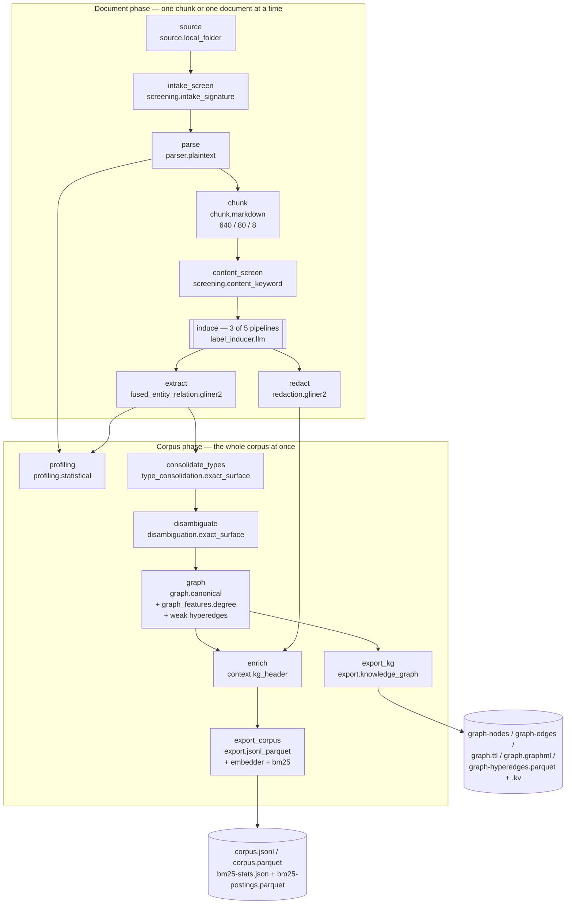

# Pipeline anatomy — the through-line

!!! warning "Written before the retrieval tooling was removed"
    This page predates [ADR-0068](../adr/0068-query-time-retrieval-tooling-is-removed-embedders-stay-only-as-a-resolution-signal.md), which removed the query-time retrieval
    tooling together with Context Enrichment (`enrich`), graph features, hyperedges, the
    BM25 / sparse / multi-vector export signals and the Qdrant sink. Chapters 4 (enrichment and export) and 5 (retrieval) were removed with it; mentions of hyperedges, graph features, the context header, BM25 and retrieval on this page and in chapters 1–3 describe the pipeline as it was measured, not as it is now.
    The page is kept until it is rewritten.

*One folder of messy files becomes a queryable corpus **and** a knowledge graph, and a query
that no single retriever can answer gets answered. This page is the spine: the whole system,
end to end, in one read. Each stage gets a sentence or two here and a chapter of its own
underneath.*

Everything below is the stack **as it is actually configured today** — the five pipeline
files the benchmark campaign ran, at
`benchmark/sota-campaign/stages/s3-pipeline/pipelines/`. Model ids, defaults and config
values are read out of the implementation, not out of prose: where a doc and the code
disagreed, the code won and the doc was corrected.

---

## The through-line, in one paragraph

A folder of files is enumerated and each file is content-addressed and stamped with
provenance. Anything oversized, spoofed or zip-bombed is quarantined *before* it is parsed.
What survives is turned into markdown — by a plain byte decoder if it is born-digital, by a
served vision-language model if it is a scan or a page image — and split into overlapping,
offset-preserving chunks that can still name the exact page and character range they came
from. Each chunk is screened again, optionally given its own small induced label schema, and
run through one model that extracts entities *and* the relations between them in a single
pass; a second model of the same family finds PII. Then the pipeline crosses a line: from
here on it sees the whole corpus at once. It canonicalises the drifted type vocabulary,
resolves mentions into single entities, assembles an evidence-linked graph — nodes, edges,
and *hyperedges* — stamps centrality and community onto every node, and projects that graph
back onto every chunk as a compact context header. Two exports fall out: a knowledge graph as
portable files, and a RAG corpus whose text carries a dense embedding, BM25 term statistics,
and the denormalised graph columns. At query time a stateless library fetches from **your**
engine, fuses dense and BM25, rescores with the graph columns, *appends* what graph traversal
rescued, and spends a token budget on the result.

The corpus and the graph are one artifact, not two, because the chunks carry the graph's node
ids and the graph's edges carry the chunks' evidence. Split them and both halves stop working.

---

## The DAG

The five campaign pipelines are the same shape. Two of them (`multihop_rag`,
`wiki2multihop`) run **14 stages**; the three whose schema is induced rather than
hand-authored (`uda`, `ohr_bench`, `vidoseek`) run **15**, adding `induce` between
`content_screen` and `extract`.

The horizontal line between the two subgraphs is load-bearing. Everything above it is
**document-level**: it sees one chunk or one document, never aggregates, and therefore
parallelises freely and can be *reused unchanged* on an incremental delta. Everything below is
**corpus-level**: it consumes the whole corpus to produce its answer. The framework enforces
this as an invariant — a chunk-level stage may not depend on a corpus-level one — and the
declaration lives in `CapabilityDescriptor.level`, one field per Capability, checked
exhaustively at import.

That invariant is why redaction and extraction both hang off `induce` rather than off each
other, and why `enrich` (which re-emits the whole chunk stream) is deliberately *not* treated
as an accumulator even though it is corpus-level.

---

## The stage roster

| # | Stage | Capability | Configured Provider | What it produces |
|---|---|---|---|---|
| 1 | `source` | `source` | `source.local_folder` | one `ParserInput` per file: raw bytes + content-addressed `document_id`, file name/type/size, detected language, `sensitivity: internal` |
| 2 | `intake_screen` | `intake_screening` | `screening.intake_signature` | the same `ParserInput`s minus the quarantined ones — size ceiling `26,214,400` bytes, zip ratio `100.0`, magic-byte vs extension mismatch |
| 3 | `parse` | `parse` | `parser.plaintext` | a `DocumentRecord`: decoded markdown plus a page map, so every later offset resolves to a page |
| 4 | `chunk` | `chunk` | `chunk.markdown` | `ChunkRecord`s at `max_tokens: 640`, `overlap_tokens: 80`, `min_tokens: 8`, each carrying its half-open character span in the parsed markdown |
| 5 | `content_screen` | `content_screening` | `screening.content_keyword` | chunks that passed the injection / harmful-content / sensitivity-escalation checkpoint, plus per-record findings for the Quality Report |
| 5b | `induce` *(uda, ohr_bench, vidoseek)* | `schema_induction` | `label_inducer.llm` | each chunk stamped with its own induced entity / relation / PII label set — `granularity: chunk`, `max_labels: 40`, `temperature: 0.0`, `max_concurrency: 32` |
| 6 | `extract` | `fused_entity_relation` | `fused_entity_relation.gliner2` | `EntityMention` **and** `RelationMention` records from one forward pass, `threshold: 0.5`, offsets mapped back to the original document |
| 7 | `redact` | `redaction` | `redaction.gliner2` | each chunk's `masked_content` + `pii_spans`; `guardrails: true` |
| 8 | `profiling` | `profiling` | `profiling.statistical` | `FeatureRecord`s: per-document density / readability / Zipf / compression, plus corpus-level entity frequency and co-occurrence |
| 9 | `consolidate_types` | `type_consolidation` | `type_consolidation.exact_surface` | every mention and relation relabelled onto one canonical type vocabulary, with the raw induced label kept for audit |
| 10 | `disambiguate` | `disambiguation` | `disambiguation.exact_surface` | `DisambiguationRecord`s: canonical entities (mentions merged) and normalised relations |
| 11 | `graph` | `graph_assembly` | `graph.canonical` | `GraphRecord`s at three scopes — `NODE`, `EDGE` (each with its Evidence sentence), and `HYPEREDGE` — with `graph_features.degree` stamping centrality + community onto every node |
| 12 | `enrich` | `context_enrichment` | `context.kg_header` | the same chunk stream, each chunk now carrying a `ContextHeader` (`max_neighbors_per_entity: 4`, `max_triples: 6`) and the denormalised KG columns |
| 13 | `export_kg` | `export` | `export.knowledge_graph` | `graph-nodes.parquet`, `graph-edges.parquet`, `graph.ttl`, `graph.graphml`, `graph-hyperedges.parquet`, `graph-hyperedges.kv` |
| 14 | `export_corpus` | `export` | `export.jsonl_parquet` | `corpus.jsonl` + `corpus.parquet` with the dense embedding and KG columns, plus `bm25-stats.json` and `bm25-postings.parquet` |

Each row is one **Capability** (a narrow typed interface) fulfilled by one **Provider** (a
plugin resolved by entry-point name at run time). Every Capability's exact input shape,
carrier type and alternative Providers are generated from the source into
`docs/reference/stage-contracts.json` and rendered as the
[stage contract reference](../reference/stage-contracts.md) — that file, not this page, is the
authority on I/O.

### Configured values that are simply the code defaults

Worth knowing which knobs were actually turned. The chunk budget was: `ChunkBudget` defaults
to `512 / 64 / 16` and the campaign runs `640 / 80 / 8`. The hyperedge block was **not**:
`weak_hyperedges: true, max_arity: 12, min_tokens: 25, max_tokens: 180,
max_window_sentences: 3` is exactly `HyperedgeConfig`'s default. Nor was the enrichment
block: `max_neighbors_per_entity: 4, max_triples: 6` are the Provider's defaults too. The
extraction threshold `0.5` and the embedding dimension `768` are also defaults.

### One flag that is not a default, and says so

`export_corpus` sets `unsafe_unmasked_corpus: true`. The code's default is `False`, and the
YAML records why it was flipped:

> Benchmark corpus: PII spans stay recorded in `pii_spans`/`masked_content`, but the exported+embedded text is the RAW content. Measured 2026-08-07: with masking on, 82% of 2Wiki/MultiHop-RAG rows carried `[PERSON]`-style placeholders INCLUDING the article titles the questions target, and the reused M6 musique/hotpot exports are unmasked — so retrieval numbers were neither valid nor cross-comparable.

The detection still runs and every finding is still written; only the substitution into the
exported text is skipped, and the Export logs a warning naming the risk once per run. This is
what the project's temperament looks like in practice: the unsafe option exists, it is named
`unsafe_`, it is off by default, and the one place it is on carries the measurement that
justified it.

---

## The model roster

Six models appear in the configured stack. Every licence below is read from the Provider's own
`ProviderProfile`, which records **weights and code separately** with a citation and a
verification date — that is the framework's licence contract, not a summary someone typed.

| Model | Stage | Weights / code | Why this one |
|---|---|---|---|
| `lightonai/LightOnOCR-2-1B` | Parse, via `parser.lighton_vllm` (served over an OpenAI-compatible vLLM endpoint) | Apache-2.0 / Apache-2.0, verified 2026-07-09 | A 1B VLM reads *pixels*, so scans and complex layouts survive where a text extractor mangles them. Served rather than in-process because vLLM batching is where the throughput is, and because an endpoint keeps a VLM's dependency stack away from the learned models downstream. |
| `lightonai/LightOnOCR-1B-1025` | Parse, via `parser.lighton` (in-process `transformers`) | Apache-2.0 / Apache-2.0, verified 2026-07-08 | The single-box path: same capability, no server to stand up. Note that these are **two packages pinning two different checkpoints** — `latence-parser-lighton` serves 1B-1025 in-process, `latence-parser-lighton-vllm` serves LightOnOCR-2-1B over HTTP. Both were licence-verified independently. |
| `fastino/gliner2-multi-v1` | `extract` (`fused_entity_relation.gliner2`) | Apache-2.0 / Apache-2.0, verified 2026-07-10 | Zero-shot, so it extracts *that chunk's* induced labels with no task-specific fine-tuning; and fused, so entities and relations come out of one forward pass instead of two models disagreeing about spans. |
| `fastino/GLiNER2-Guardrails-PII-Multi` | `redact` (`redaction.gliner2`) | Apache-2.0 / Apache-2.0, verified 2026-07-09 | The same GLiNER2 engine family the extractor already loads, so PII detection adds no second model library to the environment. |
| `deepseek/deepseek-v4-flash-0731` | `induce` (`label_inducer.llm`, via OpenRouter) | Hosted API — **no weights licence**; the Provider declares `model_id=None` and only its own Apache-2.0 client code | Chosen on measured cost: `$0.000118` per call against `$0.00042` for `gpt-4.1-mini` at comparable schema quality in a live 10-example A/B. 247,944 calls across three datasets cost ≈ `$29.26` against a `$150` cap. The in-code default is still `gpt-4.1-mini`; any OpenAI-compatible endpoint works. |
| `ibm-granite/granite-embedding-311m-multilingual-r2` | `export_corpus` (`embedding.sentence_transformers`, nested under the Export) | Apache-2.0 / Apache-2.0, verified 2026-07-14 | Permissive multilingual dense embedder on an Apache-2.0 ModernBERT backbone, 768-dim, running in-process. It is the framework default ([ADR-0045](../adr/0045-granite-r2-default-embedder-gpu-311m-fa2-bf16-cpu-97m.md)); the 97m sibling is the CPU tier. |

Two more models are available and were deliberately **not** in the measured stack —
`knowledgator/gliner-linker-large-v1.0` behind `disambiguation.glinker` (Apache-2.0 / Apache-2.0,
verified 2026-07-14) and the ULTRA link-prediction weights `mgalkin/ultra_3g` behind
`graph_completion.ultra` (MIT / MIT, verified 2026-07-09). The campaign ran the deterministic
`exact_surface` resolver and no graph completion at all, so **every benchmark number below was
produced without inferred edges**.

Everything else in the roster is a **zero-model Provider**: the chunker, both screeners, the
profiler, the type consolidator, the exact-surface disambiguator, the graph assembler, the
degree feature computer, the context enricher, both exports and the BM25 tokenizer are
pure-Python, deterministic and dependency-free, carrying the repository's own Apache-2.0
licence and no weights. That is not an accident of scope — it is the reason a run reproduces
byte for byte, and the reason a CPU host can execute most of the DAG.

**The licence discipline, stated once.** Default reference Providers must have permissive
weights *and* permissive code, verified separately and recorded before they ship
([ADR-0012](../adr/0012-permissive-only-reference-providers-gemma-opt-in.md)). The one
restricted-licence family in the ecosystem — Gemma — is explicitly non-default and opt-in,
because its flow-down obligations bind every downstream recipient. The framework's own
outbound licence is Apache-2.0
([ADR-0063](../adr/0063-relicence-to-apache-2-0.md)); `NOTICE` carries the full provenance.

---

## The deliverable is files

Nothing here is a live database. The run's output is a directory
([ADR-0017](../adr/0017-ai-ready-deliverable-is-rag-corpus-plus-kg-as-files.md)):

- **The graph** — `graph-nodes.parquet` and `graph-edges.parquet` (Arrow/Delta-native),
  `graph.ttl` (RDF Turtle for a triple store), `graph.graphml` (yEd / Gephi / networkx),
  `graph-hyperedges.parquet` plus the `graph-hyperedges.kv` point-lookup sidecar.
- **The corpus** — `corpus.jsonl` (streaming, diffable) and `corpus.parquet` (columnar),
  every row carrying the chunk text, its provenance, its `pii_spans` and `masked_content`,
  its 768-dim embedding, and the denormalised KG columns (`kg_node_ids`,
  `neighbor_node_ids`, `kg_node_community`, `kg_node_centrality`).
- **The lexical signal** — `bm25-stats.json` (corpus df / avgdl / Robertson idf) and
  `bm25-postings.parquet` (per-record forward postings), written by a tokenizer whose term
  unit exactly matches the query-side one.
- **The Quality Report** and the run manifest.

All IO crosses an fsspec seam, so `file://`, `s3://`, `gcs://` and `az://` are one line of
configuration apart ([ADR-0009](../adr/0009-fsspec-storage-seam.md)). Nothing is locked to a
vendor's store, and a downstream consumer needs no framework code to read any of it.

---

## Closing the loop: retrieval

The corpus exists to be retrieved from, and the retrieval half holds no index and runs no
first-stage search of its own — it composes over candidates *your* engine returned. The
production composition is four steps:

1. **BASE** — dense + BM25, fused by RRF *between those two only*, then max-normalised to 1.0.
2. **RESCORE** — a bounded 1-hop bonus read straight off the KG columns denormalised onto
   every chunk. No graph database in the path.
3. **RESCUE** — graph traversal and hypergraph signals contribute candidates the base
   *missed*; they are fused with each other, then **appended below** the rescored base and
   deduplicated. They never reorder the base. This asymmetry is the whole fix: the earlier
   design fused graph results in as a co-equal RRF list, and every graph leg *lowered* recall.
4. **SELECT** — a token budget is spent over the deduped union by the knapsack packer or the
   chain-of-evidence selector.

Measured on the full campaign matrix, `recall@10`, every query, no limit — and read against
**both** baselines, because only one of them is honest:

| dataset | dense | **bm25 (the strong baseline)** | graph_rescue | Δ vs dense | **Δ vs bm25** |
|---|---|---|---|---|---|
| vidoseek | 0.9466 | 0.9705 | 0.9726 | +0.026 | +0.0021 |
| ohr_bench | 0.5890 | 0.6609 | 0.6589 | +0.070 | **−0.0020** |
| uda | 0.0594 | 0.1261 | 0.1276 | +0.068 | +0.0015 |
| multihop_rag | 0.3328 | 0.3772 | 0.3759 | +0.043 | **−0.0013** |
| wiki2multihop | 0.6753 | 0.7018 | 0.7096 | +0.034 | +0.0078 |
| musique | 0.3353 | 0.3404 | 0.3404 | +0.005 | 0.0000 |
| hotpotqa | 0.5576 | 0.5786 | 0.5786 | +0.021 | 0.0000 |

Graph rescue beats the *dense* baseline on all seven datasets — but dense is not the strongest
rung, and `graph_rescue`'s own first stage already contains BM25. **Against `bm25`, the graph
lanes' contribution is within ±0.008 and negative on two.** The "+0.068 on uda" is what adding
BM25 to dense buys, not what the graph buys.

A dedicated experiment (ticket 06) settled why, and the answer is structural: with a 100–200
candidate base and rescue candidates appended below it, **no rescued candidate reaches a top-10
cut at all.** An oracle that promotes every rescued gold chunk to the front — which no shippable
policy can beat — is worth +0.0056 (multihop_rag), +0.0077 (wiki2multihop) and **exactly zero**
(vidoseek, where the graph lanes reach not one gold chunk the base missed in 1,142 queries). No
setting of `select_pool_k`, `k`, `pool_k` or fusion weight converts that into a win.

**What these numbers support** is the asymmetry itself: applied as rescue, the graph never
*lowers* recall, and fusing it demonstrably does — up to −0.11 at co-equal weight. That
containment is real and is why point 3 above is written the way it is. What they do not support
is a claim that graph traversal improves retrieval quality here. The chapter on retrieval carries
the ceiling tables, the budget curves and the latency story (median 9.8× faster after the
optimisation pass; `uda` graph_rescue 6,648 → 646 ms).

---

## The five corpora, and why one pipeline shape covers them

| corpus | what it actually is | schema | documents | chunks |
|---|---|---|---:|---:|
| `vidoseek` | page-image PDFs — long visual pages, the hardest layout | induced | 292 | 2,434 |
| `ohr_bench` | an OCR benchmark: textbooks, administrative scans, mixed quality | induced | 1,261 | 13,909 |
| `uda` | long enterprise documents — financial filings and papers, the scale case | induced | 1,917 | 220,129 |
| `multihop_rag` | born-digital news text, questions spanning articles | hand-authored | 609 | 3,264 |
| `wiki2multihop` | born-digital Wikipedia paragraphs, many small documents | hand-authored | 56,687 | 57,812 |

Three of the five arrive as PDFs or page images; two arrive as text. They nevertheless run
**the same pipeline**, for two reasons.

First, the format difference is absorbed *by the Parse Capability*, not by the pipeline shape.
The campaign materialised OCR as its own upstream stage — `lightonai/LightOnOCR-2-1B` served
on vLLM, 142,593 pages rendered, 3,470 documents assembled at 2.2–2.5 pages/second, with
10,240 pages (7%, all in 74 `uda` documents) recorded as failed rather than quietly dropped —
and handed the resulting markdown to `parser.plaintext` downstream. Swapping `parser.plaintext`
for `parser.lighton_vllm` in the same YAML would fold that step back in; nothing else in the
DAG would move. That is the Capability seam doing its job.

Second, the schema difference is absorbed *by one optional stage*. Where the domain is known,
labels are hand-authored and `induce` is simply absent (and the run makes zero LLM calls).
Where it is not, `label_inducer.llm` derives each chunk's own small label set. The extractor's
interface is identical either way, because induced labels arrive on the chunk record rather
than in the extractor's config.

**And the split follows the OCR boundary, not anyone's taste.** The three datasets that run
induction are exactly the three that came through OCR. The campaign generator declares them as
a named group — `INDUCED_DATASETS = ("ohr_bench", "vidoseek", "uda")` against
`TEXT_DATASETS = ("multihop_rag", "wiki2multihop")` — beside a comment that states the reason:
the OCR'd group induces under a budget cap, the text-native preps use hand-authored labels. The
OCR stage names the identical three (`OCR_DATASETS`) for the same reason from the other side.
So the rule is: *a corpus you had to read off a page is a corpus whose schema you do not
already know.* Both facts are declarations in code, which is why the five YAMLs are generated
rather than hand-tuned — and why the header of each one says so.

The scale range is the point worth dwelling on for anyone sizing this: 292 documents to
56,687; 2,434 chunks to 220,129; 809 relations to 90,076. The document-phase cost is a
function of worker count, not corpus size; the corpus phase runs once, on already-extracted
records rather than on raw text. `uda` — 220k chunks, 2.6M mentions, 677k hyperedges — is the
case that forced the streaming work, and the fixes are recorded rather than smoothed over.

**A note on reproducibility, because it changed a published number.** Determinism here means
`PYTHONHASHSEED=0` **and** pinned BLAS threads. Running the same code, corpus and 1,209
queries at `OMP_NUM_THREADS=4` instead of `1` gave 33 queries a different dense pool, 4 a
different top-10, and exactly one a different gold-hit count — enough to move a reported
`recall@10` in the fourth decimal. The contract now refuses to run unless `OMP_NUM_THREADS`,
`OPENBLAS_NUM_THREADS` and `MKL_NUM_THREADS` are all pinned to 1. A benchmark that lets the
thread scheduler edit its results is not a benchmark, and the fix belongs in the harness
rather than in a note asking operators to remember.

---

## Swapping any of it

Every row of the stage roster names a Capability, and every Capability has more than one
Provider. `parser.plaintext` can become `parser.document`, `parser.pdfplumber`,
`parser.lighton`, `parser.lighton_vllm`, `parser.glm`, `parser.render` or `parser.endpoint`.
`disambiguation.exact_surface` can become `.cascade`, `.embedding` or `.glinker`.
`chunk.markdown` can become `chunk.sentence_window`. `graph_features.degree` can become
`.pagerank`. Your own Provider needs no base class and no import of core — a Capability is a
structural `typing.Protocol`, so anything with the right shape registers under the
`latence.providers` entry-point group and resolves by name
([ADR-0004](../adr/0004-capability-protocols-with-provider-plugins.md)).

The **conformance suite** is what makes that a guarantee rather than a hope: it drives every
Provider through its Capability's case and checks contract adherence, graceful failure,
declared licence and declared determinism. Replacing LightOn with docling, or GLiNER2 with
your own extractor, cannot break the flow. What it *can* change is quality — and that stays
the responsibility of whoever introduces the Provider. See the
[conformance guide](../CONFORMANCE.md) and the
[stage contract reference](../reference/stage-contracts.md).

---

## Where to go next

**The chapters.** Each takes one segment of the DAG and goes all the way down — the
interface, the Provider, the model, every configured value and why it has that value, what
flows in and out, what breaks if it is wrong, and which alternatives exist.

- [1 · Ingest and document understanding](01-ingest-and-document-understanding.md) —
  source, intake screening, parse, chunk, content screening.
- [2 · Extraction and privacy](02-extraction-and-privacy.md) —
  schema induction, fused entity/relation extraction, redaction, profiling.
- [3 · From corpus to knowledge graph](03-corpus-to-knowledge-graph.md) —
  type consolidation, disambiguation, graph assembly, edge prediction.

**If you are a developer**, read chapters 1 → 3 in order with a pipeline YAML open beside
them, then the [stage contract reference](../reference/stage-contracts.md) for exact I/O and
the [pipeline reference](../reference/pipeline.md) for the config schema. The
[quickstart](../quickstart.md) gets you a running pipeline first if you would rather start
from a green run.

**If you are a researcher**, this page
and its chapters are the exhaustive *what and how*. The measured evidence lives in
[the benchmark pages](../BENCHMARKS.md) and the campaign guide
([running the campaign](../guides/benchmark-campaign.md)); the decisions, with their
alternatives and their falsifiers, are in the [decision log](../adr/index.md). Chapter 3
carries the results most likely to be contested.

**If you are an architect or evaluating this for an organisation**, start with
[architecture](../concepts/architecture.md) — three orthogonal seams, and what each one buys
you — then this page's model roster and licence discipline, then
[deployment](../deployment.md) and the
[threat model](../THREAT-MODEL.md). The operational shape in one line: heavy work is
document-parallel and independent of corpus size, the corpus-wide pass runs once on extracted
records, the output is portable files on any fsspec-addressable store, incremental deltas keep
it current without reprocessing, retrieval is stateless and runs on the engine you already
own, and every model is swappable behind a conformance-tested interface with its licence
declared and dated in code.
