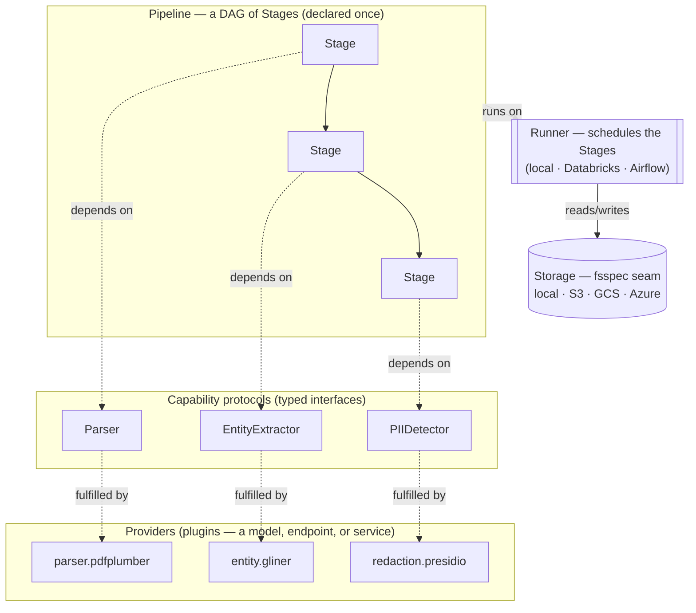

# Architecture

Latence separates *what* the pipeline does from *how* it runs and *which model* fulfils
each step. That separation is the whole design, expressed as three orthogonal seams.

## The three seams

### 1. Stage ⟂ Runner — semantics vs. scheduling

A **[Stage](../pipeline/index.md)** declares a typed input and output contract and nothing
about how it is scheduled. A **Runner** owns scheduling, retries, and checkpointing but
never defines pipeline semantics. So the *identical* Stages run under the built-in local
Runner, an Airflow DAG, or a Databricks job — you swap only the Runner
([ADR-0003](../adr/0003-stage-library-with-pluggable-runners.md),
[ADR-0030](../adr/0030-performance-path-endpoint-providers-and-second-runner-adapter.md)).

The local Runner keeps its state as **files on Storage — no database**
([ADR-0010](../adr/0010-local-runner-state-is-files-on-storage.md)), and streams records so
memory stays bounded on large corpora
([ADR-0033](../adr/0033-streaming-memory-bounded-runner.md)).

### 2. Capability ⟂ Provider — the model-agnosticity seam

A **Capability** is a narrow `typing.Protocol` — `Parser`, `EntityExtractor`,
`PIIDetector`, `Disambiguator`, … — typed against the framework's data contracts. A
**Provider** is any object with the right shape; because the Capability is a structural
protocol, a third-party Provider needs **no base class and no import of core**
([ADR-0004](../adr/0004-capability-protocols-with-provider-plugins.md)). Providers register
as entry-point plugins under `latence.providers` and are resolved by name at runtime.

The framework **never names a model** — it names Capabilities and lets Providers fulfil
them. A Provider may even be a **Fused Provider** that fulfils more than one adjacent
Stage's Capability in one pass (e.g. joint NER + Relation Extraction), which the Pipeline
permits ([ADR-0013](../adr/0013-relation-extraction-provider-chosen-empirically-fused-capability-allowed.md),
[ADR-0023](../adr/0023-relation-mention-record-and-fused-stage-routing.md)).

Every Provider declares a frozen **[`ProviderProfile`](../reference/providers.md)**: its
compute (`cpu` / `gpu` / `either`), memory footprint, model id, and *verified*
weights-and-code license. That single declared object drives device routing, the
skip-a-GPU-Provider-on-a-CPU-host posture, and the bake-off's license/cost columns
([ADR-0036](../adr/0036-provider-ecosystem-and-bakeoff.md)).

### 3. Storage — the cloud-agnostic IO seam

All IO goes through an **[fsspec](https://filesystem-spec.readthedocs.io/) seam**
([ADR-0009](../adr/0009-fsspec-storage-seam.md)), so `file://`, `s3://`, `gcs://`, and
`az://` are one line of config apart. The **AI-ready deliverable is files** — a RAG-ready
corpus *and* a knowledge graph (Parquet, JSONL, TTL, GraphML), never a live database
([ADR-0017](../adr/0017-ai-ready-deliverable-is-rag-corpus-plus-kg-as-files.md)).

## Data contracts: one schema, dual serialization

Every inter-Stage record is a Pydantic model with a single schema, serialized to **JSONL**
for streaming and inspection and **Parquet/Arrow** for columnar analytics
([ADR-0006](../adr/0006-one-schema-dual-serialization.md)). See the
[data contracts reference](../reference/contracts.md).

## Thin core, per-Provider packages

`latence-core` carries only the contract / serialization / IO / CLI spine and near-zero
dependencies. Every heavy model stack (torch, transformers, spaCy, Airflow, …) lives in
its **own Provider package**, managed as a `uv` workspace
([ADR-0016](../adr/0016-thin-core-per-provider-packages.md)). So `pip install latence-core`
stays lean, and an adopter installs only the Providers a stack actually needs.

## Incremental by construction

A corpus is a numbered, immutable **Corpus Version** on Storage. A **Delta** run reads
Version N and transactionally produces N+1, recomputing only the **Affected set** — the
blocking neighborhoods touched by changed documents — rather than the whole corpus, with a
drift-triggered **Reconciliation** correcting accumulated error
([ADR-0018](../adr/0018-incremental-corpus-deltas.md),
[ADR-0029](../adr/0029-delta-runner-affected-set-via-blocking-keys-and-source-exclusion-deletion.md)).
Deletion is dual-mode: a soft **Retraction** (audit-preserving tombstone) or a hard
**Purge** (GDPR erasure).

## Where the decisions live

This page is the map; the [Decision Log](../adr/index.md) is the territory. Start with
[ADR-0003](../adr/0003-stage-library-with-pluggable-runners.md),
[ADR-0004](../adr/0004-capability-protocols-with-provider-plugins.md), and
[ADR-0005](../adr/0005-v1-scope-the-ai-ready-data-spine.md) for the load-bearing seams.
