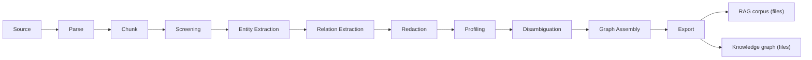

# Latence Framework

**Turn messy, siloed enterprise data into high-quality, AI-ready data — model-agnostic and cloud-agnostic.**

Latence is a pipeline framework that takes documents from where they live (a folder, an
object store, a source system) all the way to two portable, AI-ready deliverables: a
**RAG-ready corpus** and a **knowledge graph**, both written as files (ADR-0017). It
defines the *stack and orchestration contracts*; the concrete models and infrastructure
are the adopter's choice.

- **Model-agnostic.** The framework never names a model. It names **Capabilities** —
  narrow, typed interfaces like `Parser`, `EntityExtractor`, `PIIDetector` — and lets
  **Providers** (an in-process model, a remote endpoint, a cloud service) fulfil them as
  plugins. See [Capability protocols with provider plugins](adr/0004-capability-protocols-with-provider-plugins.md).
- **Cloud-agnostic.** Storage is an [fsspec seam](adr/0009-fsspec-storage-seam.md); the
  same Pipeline runs on a laptop or as an Airflow DAG through a swappable
  [Runner](adr/0003-stage-library-with-pluggable-runners.md). Two Runners ship today — the
  built-in local one and `latence-runner-airflow`; other substrates (Databricks Workflows,
  plain containers) are seam-compatible follow-ons, not shipped adapters.
- **CPU-first, offline by default.** Every Stage ships a deterministic, dependency-light
  reference Provider that runs on a laptop with no GPU and no network
  ([ADR-0007](adr/0007-cpu-first-reference-providers.md)). GPU serving is an upgrade path,
  not a prerequisite.
- **Honest about licensing.** Reference Providers ship **permissive weights only**;
  restricted-license models are opt-in ([ADR-0012](adr/0012-permissive-only-reference-providers-gemma-opt-in.md)).
  Every Provider declares a [`ProviderProfile`](reference/providers.md) with its verified
  weights-and-code license, compute, and footprint.

## The pipeline at a glance



A **Pipeline** is a DAG of **Stages** over a set of input documents, declared once and
executable by any **Runner**. Every record at every Stage carries immutable
**Provenance** back to its source, and each run emits a first-class
[**Quality Report**](adr/0008-quality-report-as-first-class-artifact.md).

## Start here

<div class="grid cards" markdown>

- :material-rocket-launch: **[Getting Started](getting-started/index.md)**
  Run the pipeline end-to-end on a fresh pod, stage by stage.

- :material-sitemap: **[Concepts & Architecture](concepts/index.md)**
  The Capability / Provider / Stage / Runner / Storage model and the project's language.

- :material-pipe: **[Pipeline Stages](pipeline/index.md)**
  What each Stage consumes and produces, Source through Export.

- :material-puzzle: **[Providers](providers/README.md)**
  The provider catalog and the guide to authoring your own.

- :material-book-open-variant: **[Guides](guides/index.md)**
  Run a stack, run a bake-off, tune per device, serve OCR with vLLM.

- :material-scale-balance: **[Decision Log (ADRs)](adr/index.md)**
  The 53 architecture decisions behind the framework.

</div>

## Install

```bash
# The dependency-light core: contracts, Capability protocols, Pipeline, local Runner, Storage.
pip install latence-core

# Providers are separate packages — install only what a stack needs, e.g.:
pip install latence-parser-pdfplumber   # CPU PDF parser
pip install latence-ner-gliner          # learned zero-shot NER
```

The core has near-zero dependencies ([ADR-0016](adr/0016-thin-core-per-provider-packages.md)):
`pydantic`, `fsspec`, `pyarrow`, `pyyaml`, `typer`. Heavy model stacks live in their own
Provider packages, so `pip install latence-core` stays lean.

!!! note "Project status"
    Latence is a personally-owned, Apache-2.0 open-source framework
    ([ADR-0001](adr/0001-open-source-core-owned-personally.md)). See the
    [README](https://github.com/ddickmann/latence-framework) for the marketing overview,
    and the [Decision Log](adr/index.md) for the reasoning behind every seam.
