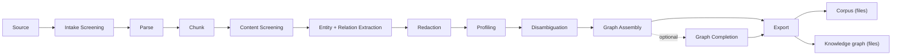

# Latence Framework

**Documents in. A corpus that carries its provenance and a knowledge graph that carries its
evidence out, as plain files.**

Latence is a Python framework that reads documents from where they live (a folder, an object
store, a source system) and writes two things as files: a corpus in which every chunk carries its
source page and character offsets, and a knowledge graph in which every edge carries the text it
was extracted from. A Redaction Stage masks PII, and the corpus export writes the masked text.

The framework names no model. Each Stage depends on a narrow typed interface, a **Capability**,
and a **Provider** package supplies the model behind it.

This page describes what the code does today. The project has been re-scoped, and that work is
not built: see [Where this is going](#where-this-is-going).

## Quick start

CPU-only, offline, no credentials:

```bash
git clone https://github.com/ddickmann/latence && cd latence
uv sync
uv run latence-demo        # runs the whole pipeline on a bundled corpus; exits non-zero on drift
```

Then on your own documents:

```bash
uv run latence setup       # guided wizard: writes a validated stack config
uv run latence process     # runs it
```

The [quickstart](quickstart.md) walks through each step and says what a correct result looks
like.

## What is built

- **Model-agnostic.** The framework names **Capabilities**, narrow typed interfaces like
  `Parser`, `EntityExtractor` and `PIIDetector`, and lets **Providers** (an in-process model, a
  remote endpoint, a cloud service) fulfil them as plugins. See
  [Capability protocols with provider plugins](adr/0004-capability-protocols-with-provider-plugins.md).
- **Cloud-agnostic.** Storage is an [fsspec seam](adr/0009-fsspec-storage-seam.md); the
  same Pipeline runs on a laptop or as an Airflow DAG through a swappable
  [Runner](adr/0003-stage-library-with-pluggable-runners.md). Two Runners ship today: the
  built-in local one and `latence-runner-airflow`. Other substrates (Databricks Workflows,
  plain containers) are seam-compatible follow-ons, not shipped adapters.
- **CPU-first, offline by default.** Every Stage ships a deterministic, dependency-light
  reference Provider that runs on a laptop with no GPU and no network
  ([ADR-0007](adr/0007-cpu-first-reference-providers.md)). GPU serving is an upgrade path,
  not a prerequisite.
- **Licences are declared per Provider.** Reference Providers ship **permissive weights only**;
  restricted-license models are opt-in ([ADR-0012](adr/0012-permissive-only-reference-providers-gemma-opt-in.md)).
  Every Provider declares a [`ProviderProfile`](reference/providers.md) with its verified
  weights-and-code license, compute, and footprint.

### The pipeline at a glance



That is the spine the blessed GPU stack declares (`stacks/gpu-sota.yaml`). Two further
Stages are **optional** and inert unless a stack declares them — Schema Induction
([ADR-0038](adr/0038-schema-induction-optional-llm-stage-induced-labels-contract-and-additive-extractor-seam.md))
and Type Consolidation
([ADR-0054](adr/0054-type-vocabulary-canonicalization-is-a-capability-of-the-resolution-phase.md))
— and an Embedder is a nested resolution signal rather than a Stage of its own
([Embedders](embedders.md)). [Pipeline Stages](pipeline/index.md) documents each of them,
with what it consumes and produces.

A **Pipeline** is a DAG of **Stages** over a set of input documents, declared once and
executable by any **Runner**. Every record at every Stage carries immutable
**Provenance** back to its source, and each run emits a first-class
[**Quality Report**](adr/0008-quality-report-as-first-class-artifact.md).

### What the repository contains

| | |
| --- | --- |
| **Packages** | 30 distributions under `packages/` — one thin core plus one package per Provider family ([ADR-0016](adr/0016-thin-core-per-provider-packages.md)). |
| **Decisions** | 73 architecture decision records in [`docs/adr/`](adr/index.md), numbered 0001–0074 (0040 was never issued). |
| **Runners** | Two shipped: the built-in local Runner and `latence-runner-airflow`. |
| **Outputs** | A corpus and a knowledge graph, as files: Parquet, JSONL, TTL, GraphML. |

## Status

Pre-1.0, one maintainer, nothing released. The suite, strict typing over source and tests, and
Provider conformance run on every change. Throughput is measured per Stage on named hardware
([performance results](perf-results.md)), and the quality suites are on the
[benchmarks page](BENCHMARKS.md). A Stage with no row there has not been measured.

Not proven: the pinned end-to-end benchmark protocol has not been run
([its page](BENCHMARKS-E2E.md) holds placeholders), extraction and resolution quality have no
current measurement, and scale beyond the measured envelopes is open. Query-time retrieval is
out of scope: that tooling was removed
([ADR-0068](adr/0068-query-time-retrieval-tooling-is-removed-embedders-stay-only-as-a-resolution-signal.md)).
The repository's
[README](https://github.com/ddickmann/latence#status) has the full list.

## Where this is going

**Nothing in this section is built.** It states decisions that are recorded and accepted.

The project was re-scoped in November 2026
([ADR-0067](adr/0067-latence-is-re-scoped-into-a-semantic-resolution-and-ontology-engine-standalone-and-as-a-metis-sidecar.md)).
It is to become an engine that builds a traceable semantic and ontology layer: canonical
concepts, their names and aliases, the relations between them, and the bindings that tie them to
physical data. Turning documents into a corpus and a graph stays, as one input path of that
engine. The name stays Latence.

- The layer is rebuilt by replaying an append-only ledger of statements and decisions, so a
  human decision survives every rebuild
  ([ADR-0069](adr/0069-the-semantic-layer-is-a-replay-of-an-append-only-ledger-of-assertions-and-decisions.md)).
- Warehouse metadata becomes an input, and row values are compared inside the customer's own
  workspace
  ([ADR-0071](adr/0071-warehouse-metadata-enters-the-pipeline-as-sources-and-row-values-are-matched-inside-the-workspace.md),
  [ADR-0072](adr/0072-on-databricks-the-engine-runs-as-jobs-in-the-workspace-and-keeps-its-state-in-delta.md)).
- Classes, properties and constraints are proposals that a human approves, exported in W3C
  standards
  ([ADR-0073](adr/0073-the-schema-level-is-induced-by-voting-signals-validated-on-data-and-exported-in-w3c-standards.md)).
- A consuming agent harness reads the result through one declared seam
  ([ADR-0070](adr/0070-metis-consumes-the-engine-through-one-proposal-file-and-otherwise-through-unity-catalog.md)).

The [roadmap](https://github.com/ddickmann/latence/blob/main/ROADMAP.md) lists this work in
priority order, next to what the current code lacks for each item.

## Find your reading path

Four kinds of reader arrive here. Each path below is **ordered** — follow it top to bottom
and you should not need to hunt for anything else.

=== "Evaluating it"

    You want to know whether the claims hold before spending a day on it.

    1. **[Concepts & Architecture](concepts/index.md)** — the five load-bearing concepts
       (Capability, Provider, Stage, Runner, Storage) and where the seams are.
    2. **[Pipeline Stages](pipeline/index.md)** — the contract of every Stage, Source
       through Export.
    3. **[Public benchmark results](BENCHMARKS.md)** — measured numbers, each carrying its
       dataset, hardware and measurement date. A Stage with no section there has not been
       measured; that is stated, never implied by silence.
    4. **[Provider catalog](providers/catalog.md)** — every shipped Provider with its
       compute, footprint and verified weights-and-code license.
    5. **[Threat model](THREAT-MODEL.md)** · **[Continuity & security process](CONTINUITY.md)**
       · **[SBOM & supply chain](SBOM.md)** — the procurement answers, each claim pointing
       at the artifact in the repository that proves it.

=== "Running it"

    You want a corpus and a knowledge graph out of a folder of documents.

    1. **[Getting Started](getting-started/index.md)** — install, `latence setup`,
       `latence process`, and what lands in the output directory.
    2. **[Run & validate a stack](running-a-stack.md)** — the blessed stacks and
       `latence stack validate`.
    3. **[Read the results — the run console](getting-started/run-console.md)** — one
       command, a localhost page, a quality verdict a non-engineer can act on.
    4. **[Tune a stack per device](tuning.md)** — `latence tune` profiles the actual box
       and keeps only settings that do not change output.
    5. **[Deploy (Compose · Helm · air-gapped)](deployment.md)** ·
       **[Observability](observability.md)** · **[Secrets handling](secrets.md)** — what
       production asks for.
    6. Going deeper: the **[fresh-pod walkthrough](TUTORIAL-fresh-pod-walkthrough.md)**
       drives the full GPU stack stage by stage, and
       **[Run a bake-off](running-a-bakeoff.md)** picks a Provider on evidence rather than
       reputation.

=== "Writing a Provider"

    You want the framework to use *your* model, endpoint or cloud service.

    1. **[Concepts & Architecture](concepts/index.md)** — what a Capability is, and why a
       Provider needs no base class and no import of core to satisfy one.
    2. **[Authoring a Provider](providers/README.md)** — the end-to-end path: implement
       one method, declare a profile, register an entry point.
    3. **[Writing an adapter with `AdapterBase`](writing-an-adapter.md)** — the optional
       helper that factors out device selection, batching and error mapping.
    4. **[ProviderProfile & device handling](provider-profile.md)** — the typed descriptor
       the framework routes device selection from.
    5. **[Passing Provider Conformance](CONFORMANCE.md)** — the C1–C6 checklist that *is*
       the definition of enterprise-ready here, and the gate every adapter package passes.
    6. **[API Reference](reference/index.md)** — the contracts, protocols and error
       taxonomy you program against, autodoc'd from the source.

=== "Contributing"

    You want to change the framework itself, or to understand why it is shaped this way.

    1. **[Decision Log (ADRs)](adr/index.md)** — the authoritative source. Every seam has
       a record with the context, the choice, and the alternatives rejected.
    2. **[Releasing](RELEASING.md)** — one version across every publishable distribution,
       and the gate that must be green before a tag.
    3. **[Continuity & security process](CONTINUITY.md)** — how vulnerabilities are
       handled, and what happens if the maintainer stops.
    4. `CONTRIBUTING.md` in the repository root — the local dev loop, the merge gate, and
       the doc-truth tests that fail the build when a page drifts from the code.

## Browse by section

<div class="grid cards" markdown>

- :material-rocket-launch: **[Get started](getting-started/index.md)**
  Install, run, and read the results.

- :material-sitemap: **[Concepts & architecture](concepts/index.md)**
  Capability / Provider / Stage / Runner / Storage, and every Stage's contract.

- :material-puzzle: **[Providers](providers/README.md)**
  The catalog, the authoring guide, and the conformance gate.

- :material-book-open-variant: **[Guides](guides/index.md)**
  Operate, tune, deploy and benchmark.

- :material-api: **[API reference](reference/index.md)**
  Contracts, protocols, Runner, Storage and errors, autodoc'd from source.

- :material-scale-balance: **[Decision log](adr/index.md)**
  The 73 architecture decisions behind the framework.

</div>

## Install

Nothing is published to PyPI — the distribution channel is the signed GitHub Release
([ADR-0062](adr/0062-distribution-is-signed-github-releases-only-no-pypi-under-polyform-noncommercial.md),
whose rationale is superseded and whose decision is reopened, not reversed, by
[ADR-0063](adr/0063-relicence-to-apache-2-0.md)). You install from a clone:

```bash
git clone https://github.com/ddickmann/latence
cd latence
uv sync

# Providers are separate packages — add only what a stack needs, by path, e.g.:
uv pip install -e packages/latence-parser-pdfplumber   # CPU PDF parser
uv pip install -e packages/latence-ner-gliner          # learned zero-shot NER
```

`uv sync` installs the dependency-light core — contracts, Capability protocols, Pipeline,
local Runner, Storage and the `latence` CLI — plus the CPU-first, offline default set. The
core has near-zero dependencies ([ADR-0016](adr/0016-thin-core-per-provider-packages.md)):
`pydantic`, `fsspec`, `pyarrow`, `pyyaml`, `typer`. Heavy model stacks live in their own
Provider packages, so the core stays lean. Step-by-step: the
[quickstart](quickstart.md).

!!! note "Project status"
    Latence is a personally-owned, open-source framework licensed under the
    [Apache License 2.0](https://www.apache.org/licenses/LICENSE-2.0); commercial use is
    granted by the licence and needs no agreement
    ([`COMMERCIAL.md`](https://github.com/ddickmann/latence/blob/main/COMMERCIAL.md)).
    Ownership and the personally-owned posture are unchanged
    ([ADR-0001](adr/0001-open-source-core-owned-personally.md)). See the
    [README](https://github.com/ddickmann/latence) for the overview,
    and the [Decision Log](adr/index.md) for the reasoning behind every seam.
