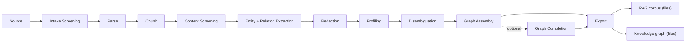

# Latence Framework

**Turn messy, siloed enterprise data into high-quality, AI-ready data — model-agnostic and cloud-agnostic.**

Latence is a pipeline framework that takes documents from where they live (a folder, an
object store, a source system) all the way to two portable, AI-ready deliverables: a
**RAG-ready corpus** and a **knowledge graph**, both written as files (ADR-0017). It
defines the *stack and orchestration contracts*; the concrete models and infrastructure
are the adopter's choice.

- **Model-agnostic.** The framework never names a model. It names **Capabilities** —
  narrow, typed interfaces like `Parser`, `EntityExtractor`, `PIIDetector` — and lets
  **Providers** (an in-process model, a remote endpoint, a cloud service) fulfil them as
  plugins. See [Capability protocols with provider plugins](adr/0004-capability-protocols-with-provider-plugins.md).
- **Cloud-agnostic.** Storage is an [fsspec seam](adr/0009-fsspec-storage-seam.md); the
  same Pipeline runs on a laptop or as an Airflow DAG through a swappable
  [Runner](adr/0003-stage-library-with-pluggable-runners.md). Two Runners ship today — the
  built-in local one and `latence-runner-airflow`; other substrates (Databricks Workflows,
  plain containers) are seam-compatible follow-ons, not shipped adapters.
- **CPU-first, offline by default.** Every Stage ships a deterministic, dependency-light
  reference Provider that runs on a laptop with no GPU and no network
  ([ADR-0007](adr/0007-cpu-first-reference-providers.md)). GPU serving is an upgrade path,
  not a prerequisite.
- **Honest about licensing.** Reference Providers ship **permissive weights only**;
  restricted-license models are opt-in ([ADR-0012](adr/0012-permissive-only-reference-providers-gemma-opt-in.md)).
  Every Provider declares a [`ProviderProfile`](reference/providers.md) with its verified
  weights-and-code license, compute, and footprint.

## The pipeline at a glance



That is the spine the blessed GPU stack declares (`stacks/gpu-sota.yaml`). Three further
Stages are **optional** and inert unless a stack declares them — Schema Induction
([ADR-0038](adr/0038-schema-induction-optional-llm-stage-induced-labels-contract-and-additive-extractor-seam.md)),
Type Consolidation
([ADR-0054](adr/0054-type-vocabulary-canonicalization-is-a-capability-of-the-resolution-phase.md))
and Context Enrichment
([ADR-0039](adr/0039-context-enrichment-optional-stage-kg-projected-onto-chunks-embedding-input-only.md))
— and embeddings are an opt-in *Export augmentation* rather than a Stage of their own
([Embedders](embedders.md)). [Pipeline Stages](pipeline/index.md) documents each of them,
with what it consumes and produces.

A **Pipeline** is a DAG of **Stages** over a set of input documents, declared once and
executable by any **Runner**. Every record at every Stage carries immutable
**Provenance** back to its source, and each run emits a first-class
[**Quality Report**](adr/0008-quality-report-as-first-class-artifact.md).

## Find your reading path

Four kinds of reader arrive here. Each path below is **ordered** — follow it top to bottom
and you should not need to hunt for anything else.

=== "Evaluating it"

    You want to know whether the claims hold before spending a day on it.

    1. **[Messy data to knowledge-graph retrieval — a deep dive](DEEP-DIVE.md)** — the
       long-form argument: what happens at each step, and why fusing a knowledge graph
       into retrieval answers questions dense and lexical search structurally cannot.
    2. **[Concepts & Architecture](concepts/index.md)** — the five load-bearing concepts
       (Capability, Provider, Stage, Runner, Storage) and where the seams are.
    3. **[Pipeline Stages](pipeline/index.md)** — the contract of every Stage, Source
       through Export.
    4. **[Public benchmark results](BENCHMARKS.md)** — measured numbers, each carrying its
       dataset, hardware and measurement date. A Stage with no section there has not been
       measured; that is stated, never implied by silence.
    5. **[Provider catalog](providers/catalog.md)** — every shipped Provider with its
       compute, footprint and verified weights-and-code license.
    6. **[Threat model](THREAT-MODEL.md)** · **[Continuity & security process](CONTINUITY.md)**
       · **[SBOM & supply chain](SBOM.md)** — the procurement answers, each claim pointing
       at the artifact in the repository that proves it.

=== "Running it"

    You want a corpus and a knowledge graph out of a folder of documents.

    1. **[Getting Started](getting-started/index.md)** — install, `latence setup`,
       `latence process`, and what lands in the output directory.
    2. **[Run & validate a stack](running-a-stack.md)** — the blessed stacks and
       `latence stack validate`.
    3. **[Read the results — the run console](getting-started/run-console.md)** — one
       command, a localhost page, a quality verdict a non-engineer can act on.
    4. **[Tune a stack per device](tuning.md)** — `latence tune` profiles the actual box
       and keeps only settings that do not change output.
    5. **[Deploy (Compose · Helm · air-gapped)](deployment.md)** ·
       **[Observability](observability.md)** · **[Secrets handling](secrets.md)** — what
       production asks for.
    6. Going deeper: the **[fresh-pod walkthrough](TUTORIAL-fresh-pod-walkthrough.md)**
       drives the full GPU stack stage by stage, and
       **[Run a bake-off](running-a-bakeoff.md)** picks a Provider on evidence rather than
       reputation.

=== "Writing a Provider"

    You want the framework to use *your* model, endpoint or cloud service.

    1. **[Concepts & Architecture](concepts/index.md)** — what a Capability is, and why a
       Provider needs no base class and no import of core to satisfy one.
    2. **[Authoring a Provider](providers/README.md)** — the end-to-end path: implement
       one method, declare a profile, register an entry point.
    3. **[Writing an adapter with `AdapterBase`](writing-an-adapter.md)** — the optional
       helper that factors out device selection, batching and error mapping.
    4. **[ProviderProfile & device handling](provider-profile.md)** — the typed descriptor
       the framework routes device selection from.
    5. **[Passing Provider Conformance](CONFORMANCE.md)** — the C1–C6 checklist that *is*
       the definition of enterprise-ready here, and the gate every adapter package passes.
    6. **[API Reference](reference/index.md)** — the contracts, protocols and error
       taxonomy you program against, autodoc'd from the source.

=== "Contributing"

    You want to change the framework itself, or to understand why it is shaped this way.

    1. **[Decision Log (ADRs)](adr/index.md)** — the authoritative source. Every seam has
       a record with the context, the choice, and the alternatives rejected.
    2. **[Architecture audit (S1)](audits/S1-architecture-audit.md)** — the adversarial
       four-lens review of the walking skeleton, kept as the worked example of the bar.
    3. **[Releasing](RELEASING.md)** — one version across every publishable distribution,
       and the gate that must be green before a tag.
    4. **[Continuity & security process](CONTINUITY.md)** — how vulnerabilities are
       handled, and what happens if the maintainer stops.
    5. `CONTRIBUTING.md` in the repository root — the local dev loop, the merge gate, and
       the doc-truth tests that fail the build when a page drifts from the code.

## Browse by section

<div class="grid cards" markdown>

- :material-rocket-launch: **[Get started](getting-started/index.md)**
  Install, run, and read the results.

- :material-sitemap: **[Concepts & architecture](concepts/index.md)**
  Capability / Provider / Stage / Runner / Storage, and every Stage's contract.

- :material-puzzle: **[Providers](providers/README.md)**
  The catalog, the authoring guide, and the conformance gate.

- :material-book-open-variant: **[Guides](guides/index.md)**
  Operate, tune, deploy, benchmark, and feed a retrieval engine.

- :material-api: **[API reference](reference/index.md)**
  Contracts, protocols, Runner, Storage and errors, autodoc'd from source.

- :material-scale-balance: **[Decision log](adr/index.md)**
  The 53 architecture decisions behind the framework.

</div>

## What the repository actually contains

| | |
| --- | --- |
| **Packages** | 33 distributions under `packages/` — one thin core plus one package per Provider family ([ADR-0016](adr/0016-thin-core-per-provider-packages.md)). |
| **Decisions** | 53 architecture decision records in [`docs/adr/`](adr/index.md), numbered 0001–0054 (0040 was never issued). |
| **Runners** | Two shipped: the built-in local Runner and `latence-runner-airflow`. |
| **Deliverables** | A RAG corpus and a knowledge graph, as files — Parquet, JSONL, TTL, GraphML ([ADR-0017](adr/0017-ai-ready-deliverable-is-rag-corpus-plus-kg-as-files.md)). |

## Install

```bash
# The dependency-light core: contracts, Capability protocols, Pipeline, local Runner, Storage.
pip install latence-core

# Providers are separate packages — install only what a stack needs, e.g.:
pip install latence-parser-pdfplumber   # CPU PDF parser
pip install latence-ner-gliner          # learned zero-shot NER
```

The core has near-zero dependencies ([ADR-0016](adr/0016-thin-core-per-provider-packages.md)):
`pydantic`, `fsspec`, `pyarrow`, `pyyaml`, `typer`. Heavy model stacks live in their own
Provider packages, so `pip install latence-core` stays lean.

!!! note "Project status"
    Latence is a personally-owned, source-available framework licensed under
    [PolyForm Noncommercial 1.0.0](https://polyformproject.org/licenses/noncommercial/1.0.0/);
    commercial use is by agreement
    ([`COMMERCIAL.md`](https://github.com/ddickmann/latence-framework/blob/main/COMMERCIAL.md)).
    Ownership and the personally-owned posture are unchanged
    ([ADR-0001](adr/0001-open-source-core-owned-personally.md)). See the
    [README](https://github.com/ddickmann/latence-framework) for the marketing overview,
    and the [Decision Log](adr/index.md) for the reasoning behind every seam.
