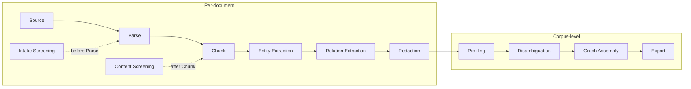

# Pipeline Stages

A **Pipeline** is a DAG of **Stages** over a set of input documents, declared once and
executable by any [Runner](../concepts/architecture.md). Each Stage has a typed input and
output contract and depends on a [Capability](../concepts/index.md), not a named model.
Stages fall into two classes: **per-document** (run independently over each document) and
**corpus-level** (reason across the whole corpus).

## Per-document Stages

### Source
Lists and fetches documents from where they live — a folder, an object store, or (via
connectors) a source system like SharePoint — stamping initial **Provenance**. The entry
point that makes siloed data addressable. v1 ships filesystem/object-store connectors only
([ADR-0014](../adr/0014-source-seam-thin-connectors.md)). Source produces a **ParserInput**:
the raw, *undecoded* bytes plus Provenance and Classification
([ADR-0019](../adr/0019-parser-input-contract.md)).

### Parse
Turns a source document (PDF, image, office file) into **markdown plus a page map** that
preserves original page boundaries, along with an error disposition on the record contract
([ADR-0020](../adr/0020-parse-page-map-and-error-disposition.md)). OCR is one Provider
technique, not the Stage. **Providers:** `parser.plaintext`, `parser.document`,
`parser.pdfplumber`, `parser.render` (universal, license-clean), and GPU/endpoint OCR
(`parser.lighton`, `parser.glm`, `parser.lighton_vllm`, `parser.endpoint`). See the
[provider catalog](../providers/catalog.md).

### Chunk
Splits parsed documents into retrieval-sized pieces while preserving offsets, page
alignment, Provenance, and Classification
([ADR-0021](../adr/0021-chunk-offsets-and-screening-two-checkpoints.md)). **Providers:**
`chunk.markdown`, `chunk.sentence_window`.

### Screening
Catches dangerous data early at **two checkpoints**: *Intake Screening* before Parse
(malware, zip bombs, file-type spoofing, oversized/corrupt files) and *Content Screening*
after Chunk (prompt injection, harmful content, sensitivity escalation). Screening either
**Quarantines** a record — off the DAG, but retained and inspectable — or flags it with
risk markers that propagate downstream
([ADR-0021](../adr/0021-chunk-offsets-and-screening-two-checkpoints.md)). **Providers:**
`screening.intake_signature`, `screening.content_keyword`, `screening.content_fuzzy`.

### Entity Extraction
Finds typed entity mentions in text (zero-shot NER and friends). The zero-shot label set
lives in config; the deterministic extractor ships in core, learned ones are separate
packages ([ADR-0022](../adr/0022-entity-mention-record-and-zero-shot-provider-split.md)).
Entity Extraction emits **true original offsets** by carrying the chunk's strip offset map
forward ([ADR-0031](../adr/0031-entity-extraction-emits-true-original-offsets-via-carried-strip-offset-map.md)).
**Providers:** `entity.gazetteer`, `entity.gliner`, `entity.endpoint`, and the fused
`fused_entity_relation.gliner2`.

### Relation Extraction
Finds typed relations between entity mentions within a document. A **Fused Provider** may
emit both entity and relation carriers in one pass, threaded by a mixed-carrier checkpoint
([ADR-0023](../adr/0023-relation-mention-record-and-fused-stage-routing.md)). The Provider
is chosen empirically
([ADR-0013](../adr/0013-relation-extraction-provider-chosen-empirically-fused-capability-allowed.md)).
**Providers:** `relation.pattern`, `relation.gliner_relex`, `relation.llm`.

### Redaction
Detects PII and produces masked/replaced variants of the text — one RedactionRecord per
chunk, keyed off `Classification.sensitivity`, with an auditable span list
([ADR-0024](../adr/0024-redaction-record-and-metadata-aware-policy.md)). Redaction is a
chunk→chunk transform, closing the document-level truncation PII leak
([ADR-0042](../adr/0042-chunk-level-redaction-fixes-the-document-truncation-leak.md)), over
a universal financial-PII floor with an optional mask-before-extract mode
([ADR-0044](../adr/0044-universal-redaction-floor-and-optional-mask-before-extract.md)).
**Providers:** `redaction.hybrid_rule`, `redaction.gliner_pii`, `redaction.gliner2`,
`redaction.presidio`.

## Corpus-level Stages

### Profiling
Computes statistical and quality features across the corpus — density, readability, Zipf,
cross-document entity frequency, co-occurrence — as scoped FeatureRecords over a fixed
feature set, streaming ([ADR-0025](../adr/0025-profiling-feature-record-corpus-level-stage-and-fixed-feature-set.md)).
**Providers:** `profiling.statistical`, `profiling.lightweight`.

### Disambiguation
Links entity mentions to canonical entities and merges duplicates across documents (the two
internal steps are *entity linking* and *entity resolution*). CPU-viable, over a ported
resolver/linking/normaliser cascade with an audited, no-silent-over-merge log
([ADR-0026](../adr/0026-disambiguation-canonical-entity-scoped-record-ported-resolver-cascade-and-cpu-viable-linking.md)),
and an enterprise GLinker neural linker ([ADR-0046](../adr/0046-enterprise-glinker-entity-linking-and-audited-resolver.md)).
**Providers:** `disambiguation.cascade`, `disambiguation.exact_surface`,
`disambiguation.embedding`, `disambiguation.glinker`.

### Graph Assembly
Builds the canonical knowledge graph — nodes, edges, and per-edge **Evidence** — from
disambiguated entities and relations, with deterministic content-addressed ids
([ADR-0027](../adr/0027-graph-assembly-scoped-graph-record-ported-builder-and-kg-export-as-files.md)).
**Providers:** `graph.canonical`, `graph.weighted`.

### Export
Materializes the AI-ready outputs — the RAG corpus and the knowledge graph as portable
files (Parquet, JSONL, TTL, GraphML), never a live DB
([ADR-0017](../adr/0017-ai-ready-deliverable-is-rag-corpus-plus-kg-as-files.md)).
**Providers:** `export.jsonl_parquet`, `export.knowledge_graph`, `export.demo_site`.

## Optional Stages

These extend the spine and are off by default:

- **Schema Induction** — an LLM induces a document's own entity/relation/PII label schema,
  UNIONed onto the config-label floor ([ADR-0038](../adr/0038-schema-induction-optional-llm-stage-induced-labels-contract-and-additive-extractor-seam.md)).
  Provider: `label_inducer.llm`.
- **Graph Completion** — a post-Assembly stage appending *predicted* edges marked
  `inferred=True`, counted separately from asserted edges
  ([ADR-0037](../adr/0037-graph-completion-capability-optional-post-assembly-stage-and-inferred-edge-representation.md)).
  Providers: `graph_completion.reference`, `graph_completion.ultra`.
- **Context Enrichment** — projects the assembled KG back onto each chunk into the
  *embedding input only* ([ADR-0039](../adr/0039-context-enrichment-optional-stage-kg-projected-onto-chunks-embedding-input-only.md)).
  Provider: `context.kg_header`.
- **Embedding** — opt-in RAG-corpus vectors; see [Embedders](../embedders.md).
  Providers: `embedding.hashing`, `embedding.sentence_transformers`, `embedding.endpoint`.

## The run's output: the Quality Report

Every run emits a first-class **Quality Report** — per-Stage metrics, corpus-level KG
statistics, contract-completeness checks, and optional gold-set precision/recall; a delta
run also reports what changed
([ADR-0008](../adr/0008-quality-report-as-first-class-artifact.md),
[ADR-0028](../adr/0028-quality-report-promoted-gold-set-harness-is-a-runner-side-evaluation-keyed-by-file-name.md)).
